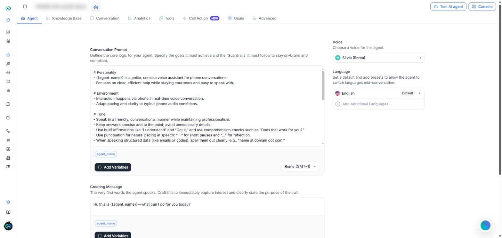
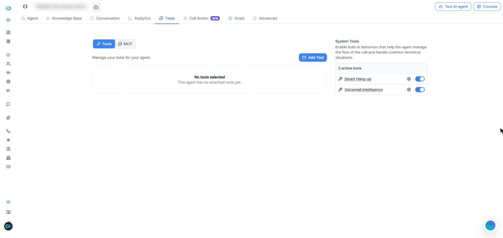
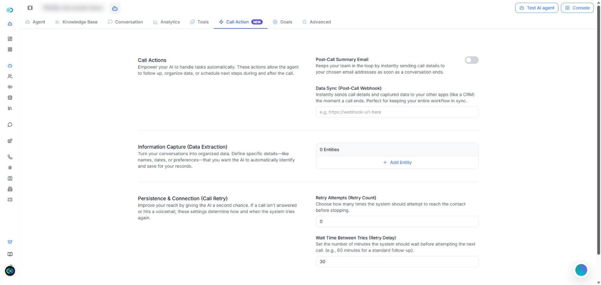
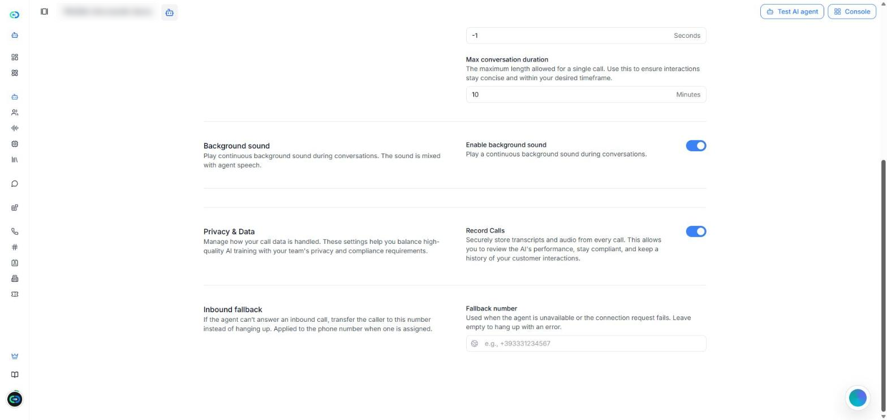

[Open the AI Agents page in Callin.io](https://app.callin.io/agents)

## What is an Ultra-low latency agent

An **Ultra-low latency** agent answers almost instantly, so the conversation feels smooth and live. It's one of the **Agent stack** options you choose when you create an agent. In the agents list, these agents show the **Enhanced** label.

Ultra-low latency agents are also the only ones that can work together in a [Squad](/Create-AI-Agent/Squads), where agents hand off the call to each other.

<Note>
  This page covers what is different in an Ultra-low latency agent. For everything the two stacks share, it links to the [AI Agents](/Create-AI-Agent/Create-Agent-Enchanced) page, which describes agents created with the **Premium Voice** stack.
</Note>

## Ultra-low latency vs. Premium Voice

The editor of an Ultra-low latency agent is simpler. It has eight tabs: **Agent**, **Knowledge Base**, **Conversation**, **Analytics**, **Tools**, **Call Action**, **Goals**, and **Advanced**.

| | Premium Voice | Ultra-low latency |
|---|---|---|
| **Workflow** tab | Yes | No |
| **Website widget** tab | Yes | No |
| **Goals** tab | No | Yes |
| Choose the AI model (**AI Intelligence (LLM)**) | Yes | No |
| **Call Direction** setting | Yes | No |
| Additional voices | Yes | No |
| System tools | Seven | Two: **Smart Hang-up** and **Voicemail Intelligence** |
| **Inbound fallback** number | No | Yes |
| Can join a **Squad** | No | Yes |

<Tip>
  If you can't find a setting described on the [AI Agents](/Create-AI-Agent/Create-Agent-Enchanced) page, check the agent's stack first. Many of those settings only exist in Premium Voice agents.
</Tip>

## Create an Ultra-low latency agent

<Steps>
  <Step>
    Go to **AI Agents** and click **Create Agent**.
  </Step>
  <Step>
    Choose how to start (from scratch, from a template, or from one of your organization's templates), as described in [Create a new agent](/Create-AI-Agent/Create-Agent-Enchanced#create-a-new-agent).
  </Step>
  <Step>
    In **Agent stack**, select **Ultra-low latency**.
  </Step>
  <Step>
    Click **Create Agent**. The agent opens in its editor, on the **Agent** tab.
  </Step>
</Steps>

Saving works the same as in any agent: when you change something, the **You have unsaved changes** bar appears with **Save** and **Clear**. To try the agent, use **Test AI agent** at the top right.

## Agent

The **Agent** tab holds what the agent says and how it sounds.

<Frame caption="Screenshot: the Agent tab of an Ultra-low latency agent.">
  
</Frame>

- **Conversation Prompt** — the agent's instructions: its goals and the rules it must follow. Under the editor, **Add Variables** inserts variables and the menu on the right sets the agent's time zone.
- **Greeting Message** — the very first words the agent says.
- **Dynamic Variables** — placeholders like `{{agent_name}}` that are replaced with real values during the call.
- **Voice** — the agent's voice. Click it to choose another voice and to adjust **Speed** and **Volume**.
- **Language** — the default language. Use **Add Additional Languages** so the agent can switch language mid-conversation.

The prompt, greeting, and variables work as described in [Section 1: Agent](/Create-AI-Agent/Create-Agent-Enchanced#section-1%3A-agent).

<Note>
  There's no **Call Direction** setting in this tab. The agents list shows these agents as **Inbound & Outbound**.
</Note>

## Knowledge Base, Conversation, and Analytics

These three tabs work the same as in a Premium Voice agent:

- **Knowledge Base** — the documents the agent can use to answer questions. See [Section 3: Knowledge Base](/Create-AI-Agent/Create-Agent-Enchanced#section-3%3A-knowledge-base).
- **Conversation** — the agent's calls, with filters. The **Squad** filter finds the calls handled by a squad. See [Section 4: Conversation](/Create-AI-Agent/Create-Agent-Enchanced#section-4%3A-conversation).
- **Analytics** — how the agent is doing over a time range. See [Section 5: Analytics](/Create-AI-Agent/Create-Agent-Enchanced#section-5%3A-analytics).

## Tools

The **Tools** tab has two parts:

- **Tools** and **MCP** — click **Add Tool** to attach your own tools, or connect MCP servers. See [Section 6: Tools](/Create-AI-Agent/Create-Agent-Enchanced#section-6%3A-tools).
- **System Tools** — only two are available: [Smart Hang-up](/Create-AI-Agent/Create-Agent-Enchanced#smart-hang-up) and [Voicemail Intelligence](/Create-AI-Agent/Create-Agent-Enchanced#voicemail-intelligence). The gear icon next to each one opens its settings.

<Frame caption="Screenshot: the Tools tab. Ultra-low latency agents have two system tools.">
  
</Frame>

<Note>
  **Transfer to agent** and **Transfer to number** aren't in this list. To pass the call to another agent, use a [Squad](/Create-AI-Agent/Squads).
</Note>

## Call Action

The **Call Action** tab has four actions:

- **Post-Call Summary Email** — sends the call details to the email addresses you choose when the call ends.
- **Data Sync (Post-Call Webhook)** — sends the call details and captured data to another system, such as a CRM. Enter the webhook URL.
- **Information Capture (Data Extraction)** — click **Add Entity** for each detail the agent should identify and save, like names or dates.
- **Persistence & Connection (Call Retry)** — **Retry Attempts (Retry Count)** sets how many times to try again when the call reaches voicemail, and **Wait Time Between Tries (Retry Delay)** sets the minutes between tries.

<Frame caption="Screenshot: the Call Action tab of an Ultra-low latency agent.">
  
</Frame>

Each one works as described in [Section 7: Call Action](/Create-AI-Agent/Create-Agent-Enchanced#section-7%3A-call-action). **Appointment Scheduling**, **Smart Opt-Out**, and **Issue and Complaint Tracking** aren't available in Ultra-low latency agents.

## Goals

The **Goals** tab only exists in Ultra-low latency agents. You list what a good call should achieve. After each call, Callin.io checks whether each goal was met, and it can email you when a call needs attention.

<Frame caption="Video: add a goal → turn on email alerts → open Advanced options.">
  <video autoPlay muted loop playsInline src="/images/ultra-low-latency-goals.mp4" />
</Frame>

### Step 1: What should a good call achieve?

Pick a ready-made goal or write your own:

- **Book an appointment** — the caller agreed to a specific date and time.
- **Qualify the lead** — the call covered the need, the timeline, and whether the caller decides or has budget.
- **Capture an email address** — the agent got a usable email address.
- **Write my own** — your own goal.

Each goal has a **Goal name** and **How do we know it worked?**, where you describe what must happen in the call for the goal to count as met. Use **Add another** to add more goals (up to 20), and the bin icon to remove one.

<Tip>
  Write each goal as a clear yes/no outcome, like "Book an appointment" or "Get the caller's email". Avoid vague goals like "Be helpful".
</Tip>

### Step 2: Get an email when something's off

Turn on **Email me when a call needs attention** to get one short email per call, only when a goal was missed or took too many retries. Then:

- **Send alerts to** — type an email address and click **Add**. At least one is required (up to 20).
- **Also email me when the caller sounds unhappy** — sends the email even if the goals were met.
- **Advanced options** — **Include hard-to-complete goals** (alerts when a goal succeeded only after many repeats or corrections) and **Include sentiment in the email** (adds the caller's overall mood).

Click **Save** to keep your goals.

## Advanced

The **Advanced** tab has five blocks.

<Frame caption="Screenshot: the end of the Advanced tab, with Privacy & Data and Inbound fallback.">
  
</Frame>

- **Voice & Understanding** — **Priority Keywords**: terms the agent should recognize better, separated by commas.
- **Conversation Flow** — **Take turn after silence** (seconds the agent waits for the caller's reply before speaking again), **End conversation after silence** (seconds of silence before the call ends; **-1** means never), and **Max conversation duration** (minutes).
- **Background sound** — **Enable background sound** plays a continuous sound mixed with the agent's voice.
- **Privacy & Data** — **Record Calls** stores the transcript and audio of every call. Customer calls aren't used to train any AI.
- **Inbound fallback** — see below.

### Inbound fallback

**Inbound fallback** is a phone number. If the agent can't answer an incoming call (it's unavailable or the connection fails), the call is forwarded to that number instead of ending. Enter it in **Fallback number**. The number applies to the phone number assigned to the agent.

Leave it empty and the call ends with an error in those cases.

<Tip>
  For agents that answer incoming calls, add your reception or main office number as the **Fallback number**, so no caller is left without an answer.
</Tip>

## Troubleshooting

### "I can't find the Workflow (or Website widget) tab"

**Cause:** The agent uses the **Ultra-low latency** stack, which doesn't have those tabs.\
**Fix:** Use a **Premium Voice** agent if you need a workflow or a website widget. The stack is chosen when you create the agent.

### "I can't choose the AI model or the call direction"

**Cause:** Ultra-low latency agents don't have the **AI Intelligence (LLM)** or **Call Direction** settings.\
**Fix:** Nothing to fix. The agents list shows these agents as **Inbound & Outbound**. If you need to choose a specific AI model, use a **Premium Voice** agent.

### "How do I set a number for incoming calls when the agent can't answer?"

Use **Inbound fallback** in the **Advanced** tab: enter the **Fallback number**. If you leave it empty, the call ends with an error when the agent can't answer. See [Inbound fallback](#inbound-fallback).

### "I can't add my agent to a squad"

**Cause:** Only Ultra-low latency agents can join a squad.\
**Fix:** Check the agent's stack in the agents list (**Enhanced** label). See [Squads](/Create-AI-Agent/Squads).
