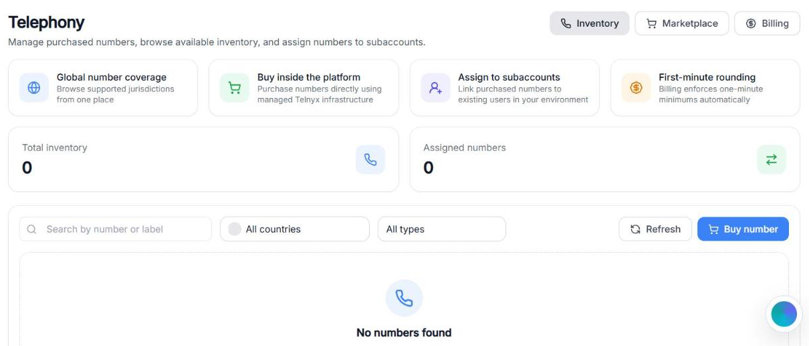
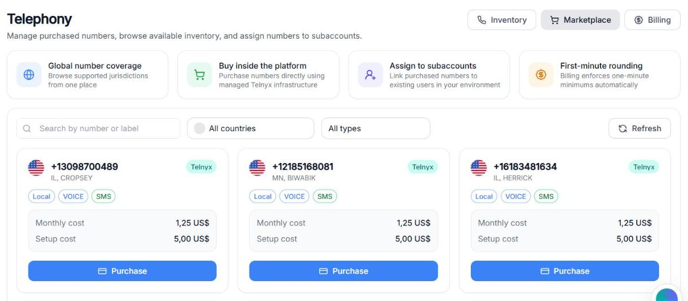
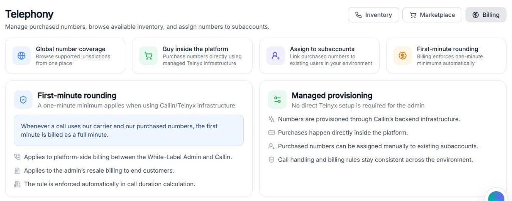

Im Bereich **Telefonie** beschaffen Sie als White-Label-Administrator die Telefonnummern für die Agenten, die auf Ihrer Plattform laufen. Sie kaufen sie einmal in Ihren eigenen Bestand und weisen von dort jede Nummer dem Unterkonto des Kunden zu, der sie braucht.

Der Bereich ist in drei Tabs gegliedert:

- **Bestand** — die Nummern, die Sie bereits besitzen.
- **Marktplatz** — der Katalog, in dem Sie neue Nummern kaufen.
- **Abrechnung** — die Regeln für die Abrechnung von Anrufen.

In allen drei Tabs sehen Sie oben vier Übersichtskarten. Sie zeigen auf einen Blick, wofür dieser Bereich da ist:

- **Globale Nummernabdeckung** — Sie können Telefonnummern aus vielen Ländern an einer Stelle durchsuchen. Praktisch, wenn Ihre Kunden in verschiedenen Regionen tätig sind.
- **Direkt auf der Plattform kaufen** — Nummern werden direkt über die von Callin verwaltete Telnyx-Infrastruktur gekauft. Sie brauchen kein eigenes Telnyx-Konto.
- **Unterkonten zuweisen** — sobald eine Nummer in Ihrem Bestand ist, können Sie sie dem Unterkonto jedes Kunden in Ihrer Umgebung zuweisen.
- **Abrechnung der ersten Minute** — ausgehende Anrufe werden mit mindestens einer Minute abgerechnet. Der Tab Abrechnung erklärt das im Detail.

Sie finden ihn in der White-Label-Plattform unter **App-Konfiguration** ([hier öffnen](https://app.callin.io/cms/telephony)).

<Frame caption="Video: Bestand → Marktplatz → Länder- und Typfilter → Abrechnung.">
  <video autoPlay muted loop playsInline src="/images/wl-telephony.mp4" />
</Frame>

<Tip>
  Öffnen Sie die Tabs beim ersten Mal der Reihe nach: Marktplatz, um zu sehen, was verfügbar ist; Bestand, um zu sehen, wo neue Nummern landen; Abrechnung, um genau zu wissen, was Ihnen berechnet wird.
</Tip>

## Bestand

Der Tab **Bestand** ist Ihr persönliches Lager für Telefonnummern. Jede Nummer, die Sie bereits gekauft haben, liegt hier und kann dem Unterkonto eines Kunden zugewiesen werden.

<Frame caption="Bildschirmfoto: der Tab Bestand. Die Zähler oben zeigen, wie viele Nummern Sie besitzen und wie viele bereits zugewiesen sind.">
  
</Frame>

Beim ersten Öffnen von Telefonie ist Ihr Bestand leer. Das ist normal: Bis zu Ihrem ersten Kauf sehen Sie die Meldung **Keine Nummern gefunden**.

### Zähler

Oben im Tab zeigen zwei Zähler den Zustand Ihres Bestands auf einen Blick:

- **Gesamtbestand** — die Gesamtzahl der Telefonnummern, die Sie besitzen.
- **Zugewiesene Nummern** — wie viele davon bereits mit dem Unterkonto eines Kunden verknüpft sind.

Die Differenz zeigt, wie viele Nummern noch frei sind und zugewiesen werden können.

### Filter und Aktionen

Mit der Filterleiste finden Sie eine bestimmte Nummer, wenn Ihr Bestand wächst:

- **Nach Nummer oder Bezeichnung suchen** — finden Sie eine Nummer über ihre Ziffern oder die Bezeichnung, die Sie ihr gegeben haben.
- **Alle Länder** — die Liste auf ein Land eingrenzen.
- **Alle Typen** — die Liste auf einen Nummerntyp eingrenzen **Lokal**, **Mobil**, **Gebührenfrei** oder **National** (im nächsten Tab erklärt).
- **Aktualisieren** — lädt die Liste neu. Nützlich direkt nach einem Kauf, falls die neue Nummer noch nicht erscheint.
- **Nummer kaufen** — eine Abkürzung zum Tab **Marktplatz**.

<Tip>
  Geben Sie jeder Nummer gleich nach dem Kauf eine klare Bezeichnung, zum Beispiel den Firmennamen des Kunden. Wenn Ihr Bestand wächst, sorgen die Bezeichnungen für Übersicht.
</Tip>

### Eine Nummer einem Unterkonto zuweisen

Sobald eine Nummer in Ihrem Bestand ist, können Sie sie jedem Unterkonto in Ihrer Umgebung zuweisen. Ein Unterkonto ist ein Kundenkonto aus der **Benutzerverwaltung** ([Benutzer](/de/Automations/Whitelabel/Clients)). Die Nummer bleibt in Ihrem Bestand; die Zuweisung erlaubt dem Kunden, sie in seinen Agenten zu verwenden.

<Steps>
  <Step>
    Öffnen Sie im Tab **Bestand** das Menü **⋮** in der Zeile der Nummer und klicken Sie auf **Zuweisen**.
  </Step>
  <Step>
    Öffnen Sie im Fenster **Nummer zuweisen** die Liste **Unterkonto auswählen** und wählen Sie den Kunden. Sie können nach Name oder E-Mail suchen.
  </Step>
  <Step>
    Klicken Sie auf **Nummer zuweisen**. Sie sehen **Nummer erfolgreich zugewiesen**, und der Zähler **Zugewiesene Nummern** steigt um eins.
  </Step>
  <Step>
    Weisen Sie die Nummer in der App des Kunden einem Agenten zu: **KI-Agenten** → **⋮** → **Nummer zuweisen**. Das kann der Kunde tun, oder Sie tun es mit **Als dieser Benutzer anmelden**. Bis dahin nutzt kein Agent die Nummer.
  </Step>
</Steps>

<Warning>
  **Häufiger Fehler:** Einen Benutzer anlegen, während **Telefonie** schon geöffnet ist. Die Liste der Unterkonten wird beim Öffnen der Seite geladen, und **Aktualisieren** lädt nur Ihren Bestand neu. Wenn ein neuer Kunde in **Unterkonto auswählen** fehlt, laden Sie die Seite im Browser neu.
</Warning>

Um eine Nummer einem anderen Kunden zu geben, öffnen Sie dasselbe Menü **⋮** und klicken Sie auf **Neu zuweisen**. Um sie freizugeben, klicken Sie auf **Zuweisung aufheben**: Die Nummer ist dann wieder in Ihrem Bestand verfügbar.

## Marktplatz

Der Tab **Marktplatz** ist der Katalog der Nummern, die Sie kaufen können. Hierher gehen Sie, wenn ein Kunde eine neue Nummer braucht, die Sie noch nicht im Bestand haben.

<Frame caption="Bildschirmfoto: der Tab Marktplatz. Jede Karte steht für eine verfügbare Nummer und zeigt alles, was Sie vor dem Kauf wissen müssen.">
  
</Frame>

### Was jede Karte zeigt

Jede Nummer erscheint als eigene Karte mit allen Informationen für Ihre Entscheidung:

- **Die Nummer selbst** im internationalen Format.
- **Länderflagge** und Stadt oder Region (zum Beispiel `TX, BELLVILLE`).
- **Anbieter** — der Netzbetreiber, der die Nummer bereitstellt (zum Beispiel Telnyx).
- **Nummerntyp** — Lokal, Mobil, Gebührenfrei oder National. Siehe unten.
- **Funktionen** — `VOICE` und/oder `SMS`, je nachdem, was die Nummer unterstützt.
- **Monatliche Kosten** — die wiederkehrende Gebühr, die jeden Monat anfällt, solange die Nummer aktiv ist.
- **Einrichtungskosten** — eine einmalige Gebühr für die Aktivierung der Nummer.
- **Kaufen** — die Schaltfläche zum Kauf.

### Nummerntypen

Beim Kauf einer Telefonnummer wählen Sie nicht nur Ziffern, sondern auch, wie Anrufer sie wahrnehmen und was sie kann. Sie können den Katalog nach Typ filtern:

- **Lokal** — eine Nummer, die an eine Stadt oder Region gebunden ist (zum Beispiel US-Nummern eines Bundesstaats). Anrufer sehen eine vertraute Vorwahl, was die Annahmequote bei lokalen Unternehmen erhöht.
- **Mobil** — eine Nummer im Mobilfunknetz. In manchen Ländern verhalten sich Mobil- und Festnetznummern unterschiedlich, besonders bei SMS.
- **Gebührenfrei** — eine Nummer, bei der der Anrufer nichts zahlt; die Kosten trägt der Inhaber der Leitung. Typisch für landesweite Kundenservice-Nummern.
- **National** — eine Nummer, die an keine Stadt gebunden ist und landesweit erkannt wird. Nützlich für Unternehmen, die Kunden im ganzen Land bedienen, ohne eine gebührenfreie Nummer anzubieten.

<Tip>
  Wählen Sie den Nummerntyp passend zu dem, was die Kunden Ihres Kunden kennen: eine lokale Nummer für ein Geschäft vor Ort, eine gebührenfreie für eine landesweite Service-Rufnummer.
</Tip>

### Suchen und filtern

Der Marktplatz hat dieselbe Filterleiste wie der Bestand:

- **Nach Nummer oder Bezeichnung suchen** — bestimmte Ziffern finden.
- **Alle Länder** — nach Land durchsuchen. Tippen Sie in die Suche, um ein Land schnell zu finden.
- **Alle Typen** — auf einen Typ eingrenzen.
- **Aktualisieren** — lädt den Katalog neu. Wenn ein Ladefehler erscheint, klicken Sie auf **Aktualisieren**, um es erneut zu versuchen.

Der Katalog umfasst diese Länder: Australien, Belgien, Bulgarien, Dänemark, Deutschland, Estland, Finnland, Frankreich, Griechenland, Indien, Irland, Island, Italien, Kanada, Kroatien, Lettland, Litauen, Luxemburg, Malta, Mexiko, Neuseeland, Niederlande, Norwegen, Österreich, Polen, Portugal, Rumänien, Schweden, Schweiz, Slowakei, Slowenien, Spanien, Südafrika, Tschechien, Ungarn, die Vereinigten Arabischen Emirate, das Vereinigte Königreich, die USA und Zypern. Verfügbare Typen und Preise variieren je nach Land.

<Warning>
  **Häufiger Fehler:** Eine Nummer kaufen, ohne ihre Funktionen zu prüfen. Eine Nummer nur mit `VOICE` kann keine SMS senden, und eine Nummer nur mit `SMS` kann keine Anrufe annehmen. Lesen Sie vor dem Klick auf **Kaufen** immer die Funktionen auf der Karte.
</Warning>

### Was nach einem Kauf passiert

Sobald Sie auf einer Karte auf **Kaufen** klicken und bestätigen:

- Die Nummer wird in Ihrem Konto aktiviert.
- Sie erscheint sofort im Tab **Bestand**.
- Die monatlichen Kosten laufen ab dem Aktivierungsdatum.
- Sie können die Nummer jedem Unterkonto eines Kunden zuweisen, sobald Sie bereit sind.

<Note>
  Nummern außerhalb der USA und Kanadas sind nicht sofort verfügbar. Sie werden mit den Unterlagen Ihres Kunden beantragt, und jedes Land verlangt andere Unterlagen. Versprechen Sie Ihren Kunden keine Nummer am selben Tag. Siehe [Nummern und BYOC](/de/Create-AI-Agent/Configure-Numbers).
</Note>

## Abrechnung

Der Tab **Abrechnung** erklärt die Regeln, die für jeden Anruf über die Plattform gelten. Hier gibt es nichts einzustellen: Die Seite dient der Information, ist aber einmal lesenswert, damit Sie auf Ihrer Rechnung keine Überraschungen erleben.

<Frame caption="Bildschirmfoto: der Tab Abrechnung. Die beiden Blöcke fassen zusammen, wie Minuten abgerechnet werden und wie die Bereitstellung der Nummern im Hintergrund erfolgt.">
  
</Frame>

### Abrechnung der ersten Minute

Wenn ein ausgehender Anruf den Netzbetreiber von Callin und über die Plattform gekaufte Nummern nutzt, wird ein Anruf unter 60 Sekunden **als volle Minute abgerechnet**, auch wenn er nur wenige Sekunden dauert. Anrufe von 60 Sekunden oder länger werden nach ihrer tatsächlichen Dauer abgerechnet. Eingehende Anrufe, Testanrufe im Browser, importierte Nummern, persönliche Nummern und externe SIP-Trunks werden immer nach ihrer tatsächlichen Dauer abgerechnet.

Konkret bedeutet das:

- Die Regel gilt für die Abrechnung zwischen Ihnen (dem White-Label-Administrator) und Callin.
- Sie gilt auch für die Weiterverkaufs-Abrechnung, die Sie für Ihre eigenen Endkunden einrichten.
- Die Regel wird bei der Berechnung der Anrufdauer automatisch angewendet; Sie müssen nichts einstellen.

<Warning>
  Berücksichtigen Sie diese Regel bei Ihren Preisen für Kunden. Wenn Sie pro Minute abrechnen, sollte Ihre kleinste abrechenbare Einheit mindestens eine Minute sein. Sonst kosten Sie kurze Anrufe mehr, als Sie einnehmen.
</Warning>

### Verwaltete Bereitstellung

Dieser Abschnitt bestätigt, dass Sie als White-Label-Administrator **Telnyx nicht selbst einrichten müssen**. Alles erledigt Callin im Hintergrund:

- Nummern werden über die verwaltete Infrastruktur von Callin bereitgestellt.
- Käufe erfolgen direkt auf der Plattform.
- Gekaufte Nummern können jederzeit manuell jedem bestehenden Unterkonto zugewiesen werden.
- Anrufverarbeitung und Abrechnungsregeln bleiben in Ihrer gesamten Umgebung einheitlich.

Kurz gesagt: Sie konzentrieren sich darauf, Telefonnummern und Kapazität an Ihre Kunden zu verkaufen; die technische Komplexität des Netzbetreibers bleibt unsichtbar.

<Tip>
  Wenn ein Kunde nach Anrufqualität, Abdeckung oder dem technischen Aufbau fragt, können Sie ihm sicher antworten, dass die Plattform auf einer verwalteten Telnyx-Infrastruktur läuft und er auf seiner Seite nichts integrieren muss.
</Tip>
