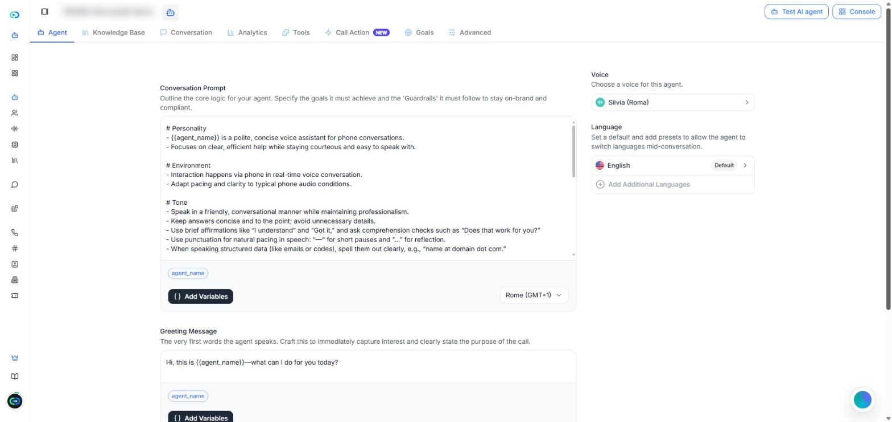
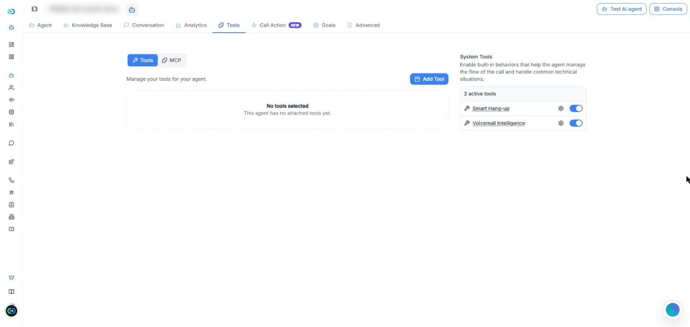
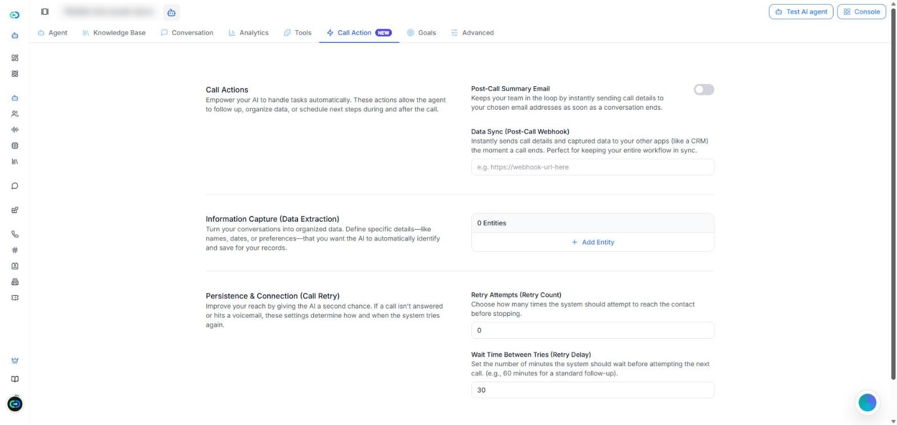
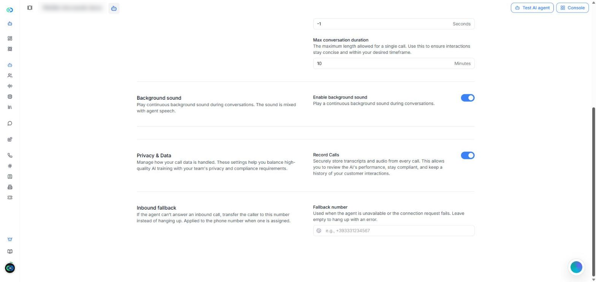

[Die Seite KI-Agenten in Callin.io öffnen](https://app.callin.io/agents)

## Was ist ein Agent mit ultraniedriger Latenz

Ein Agent mit **Ultraniedrige Latenz** antwortet fast sofort, sodass sich das Gespräch flüssig und natürlich anfühlt. Das ist eine der Optionen für den **Agent-Stack**, die Sie beim Erstellen eines Agenten wählen. In der Agentenliste tragen diese Agenten das Label **Erweitert**.

Außerdem sind sie die einzigen Agenten, die in einem [Squad](/de/Create-AI-Agent/Squads) zusammenarbeiten können, in dem sie sich den Anruf gegenseitig übergeben.

<Note>
  Diese Seite beschreibt, was bei einem Agenten mit ultraniedriger Latenz anders ist. Für alles, was beide Stacks gemeinsam haben, verweist sie auf die Seite [KI-Agenten](/de/Create-AI-Agent/Create-Agent-Enchanced), die Agenten mit dem Stack **Premium-Stimme** beschreibt.
</Note>

## Ultraniedrige Latenz und Premium-Stimme im Vergleich

Der Editor eines Agenten mit ultraniedriger Latenz ist einfacher. Er hat acht Tabs: **Agent**, **Wissensdatenbank**, **Konversation**, **Analysen**, **Tools**, **Anrufaktion**, **Ziele** und **Erweitert**.

| | Premium-Stimme | Ultraniedrige Latenz |
|---|---|---|
| Tab **Workflow** | Ja | Nein |
| Tab **Website-Widget** | Ja | Nein |
| Tab **Ziele** | Nein | Ja |
| KI-Modell wählen (**KI-Intelligenz (LLM)**) | Ja | Nein |
| Einstellung **Anrufrichtung** | Ja | Nein |
| Zusätzliche Stimmen | Ja | Nein |
| System-Tools | Sieben | Zwei: **Smartes Auflegen** und **Voicemail-Erkennung** |
| Nummer für **Inbound-Fallback** | Nein | Ja |
| Kann einem **Squad** beitreten | Nein | Ja |

<Tip>
  Wenn Sie eine Einstellung von der Seite [KI-Agenten](/de/Create-AI-Agent/Create-Agent-Enchanced) nicht finden, prüfen Sie zuerst den Stack des Agenten. Viele dieser Einstellungen gibt es nur bei Agenten mit Premium-Stimme.
</Tip>

## Einen Agenten mit ultraniedriger Latenz erstellen

<Steps>
  <Step>
    Öffnen Sie **KI-Agenten** und klicken Sie auf **Agent erstellen**.
  </Step>
  <Step>
    Wählen Sie, wie Sie beginnen möchten (von Grund auf, mit einer Vorlage oder mit einer Vorlage Ihrer Organisation), wie unter [Einen neuen Agenten erstellen](/de/Create-AI-Agent/Create-Agent-Enchanced#einen-neuen-agenten-erstellen) beschrieben.
  </Step>
  <Step>
    Wählen Sie unter **Agent-Stack** die Option **Ultraniedrige Latenz**.
  </Step>
  <Step>
    Klicken Sie auf **Agent erstellen**. Der Agent öffnet sich in seinem Editor, im Tab **Agent**.
  </Step>
</Steps>

Das Speichern funktioniert wie bei jedem Agenten: Sobald Sie etwas ändern, erscheint die Leiste **Sie haben ungespeicherte Änderungen** mit **Speichern** und **Leeren**. Zum Ausprobieren nutzen Sie **KI-Agent testen** oben rechts.

## Agent

Im Tab **Agent** legen Sie fest, was der Agent sagt und wie er klingt.

<Frame caption="Screenshot: der Tab Agent eines Agenten mit ultraniedriger Latenz.">
  
</Frame>

- **Konversations-Prompt** — die Anweisungen für den Agenten: seine Ziele und die Regeln, die er befolgen muss. Unter dem Editor fügt **Variablen hinzufügen** Variablen ein, und über das Menü rechts stellen Sie die Zeitzone des Agenten ein.
- **Begrüßungsnachricht** — die allerersten Worte des Agenten.
- **Dynamische Variablen** — Platzhalter wie `{{agent_name}}`, die während des Anrufs durch echte Werte ersetzt werden.
- **Stimme** — die Stimme des Agenten. Klicken Sie darauf, um eine andere Stimme zu wählen und **Geschwindigkeit** und **Lautstärke** einzustellen.
- **Sprache** — die Standardsprache. Mit **Weitere Sprachen hinzufügen** kann der Agent mitten im Gespräch die Sprache wechseln.

Prompt, Begrüßung und Variablen funktionieren wie in [Abschnitt 1: Agent](/de/Create-AI-Agent/Create-Agent-Enchanced#abschnitt-1%3A-agent) beschrieben.

<Note>
  In diesem Tab gibt es keine Einstellung **Anrufrichtung**. Die Agentenliste zeigt diese Agenten als **Eingehend & Ausgehend** an.
</Note>

## Wissensdatenbank, Konversation und Analysen

Diese drei Tabs funktionieren wie bei einem Agenten mit Premium-Stimme:

- **Wissensdatenbank** — die Dokumente, die der Agent für seine Antworten nutzen kann. Siehe [Abschnitt 3: Wissensdatenbank](/de/Create-AI-Agent/Create-Agent-Enchanced#abschnitt-3%3A-wissensdatenbank).
- **Konversation** — die Anrufe des Agenten, mit Filtern. Der Filter **Squad** zeigt die Anrufe, die ein Squad bearbeitet hat. Siehe [Abschnitt 4: Konversation](/de/Create-AI-Agent/Create-Agent-Enchanced#abschnitt-4%3A-konversation).
- **Analysen** — wie der Agent in einem Zeitraum abschneidet. Siehe [Abschnitt 5: Analysen](/de/Create-AI-Agent/Create-Agent-Enchanced#abschnitt-5%3A-analysen).

## Tools

Der Tab **Tools** hat zwei Teile:

- **Tools** und **MCP** — klicken Sie auf **Werkzeug hinzufügen**, um eigene Tools hinzuzufügen, oder verbinden Sie MCP-Server. Siehe [Abschnitt 6: Tools](/de/Create-AI-Agent/Create-Agent-Enchanced#abschnitt-6%3A-tools).
- **System-Tools** — es gibt nur zwei: [Smartes Auflegen](/de/Create-AI-Agent/Create-Agent-Enchanced#intelligentes-auflegen) und [Voicemail-Erkennung](/de/Create-AI-Agent/Create-Agent-Enchanced#mailbox-intelligenz). Das Zahnradsymbol neben jedem Tool öffnet seine Einstellungen.

<Frame caption="Screenshot: der Tab Tools. Agenten mit ultraniedriger Latenz haben zwei System-Tools.">
  
</Frame>

<Note>
  **An Agent übergeben** und **An Nummer übergeben** sind nicht in dieser Liste. Um den Anruf an einen anderen Agenten weiterzugeben, nutzen Sie einen [Squad](/de/Create-AI-Agent/Squads).
</Note>

## Anrufaktion

Der Tab **Anrufaktion** bietet vier Aktionen:

- **E-Mail-Zusammenfassung nach dem Anruf** — sendet die Anrufdetails nach Gesprächsende an die E-Mail-Adressen Ihrer Wahl.
- **Daten-Sync (Webhook nach Anruf)** — sendet die Anrufdetails und die erfassten Daten an ein anderes System, zum Beispiel ein CRM. Geben Sie die Webhook-URL ein.
- **Informationserfassung (Datenextraktion)** — klicken Sie für jede Angabe, die der Agent erkennen und speichern soll, auf **Entität hinzufügen**, zum Beispiel Namen oder Daten.
- **Wiederholung & Verbindung (Anruf-Wiederholung)** — **Wiederholungsversuche (Anzahl)** legt fest, wie oft es erneut versucht wird, wenn die Mailbox drangeht, und **Wartezeit zwischen Versuchen (Wiederholungsverzögerung)** legt die Minuten zwischen den Versuchen fest.

<Frame caption="Screenshot: der Tab Anrufaktion eines Agenten mit ultraniedriger Latenz.">
  
</Frame>

Jede funktioniert wie in [Abschnitt 7: Anrufaktion](/de/Create-AI-Agent/Create-Agent-Enchanced#abschnitt-7%3A-anrufaktion) beschrieben. **Terminplanung**, **Intelligenter Opt-Out** und **Problem- und Beschwerdeverfolgung** gibt es bei Agenten mit ultraniedriger Latenz nicht.

## Ziele

Den Tab **Ziele** gibt es nur bei Agenten mit ultraniedriger Latenz. Hier legen Sie fest, was ein guter Anruf erreichen soll. Nach jedem Anruf prüft Callin.io, ob jedes Ziel erreicht wurde, und kann Sie per E-Mail benachrichtigen, wenn ein Anruf Aufmerksamkeit braucht.

<Frame caption="Video: ein Ziel hinzufügen → E-Mail-Benachrichtigungen einschalten → Erweiterte Optionen öffnen.">
  <video autoPlay muted loop playsInline src="/images/ultra-low-latency-goals.mp4" />
</Frame>

### Schritt 1: Was soll ein guter Anruf erreichen?

Wählen Sie ein vorbereitetes Ziel oder schreiben Sie ein eigenes:

- **Termin buchen** — der Anrufer hat einem bestimmten Datum und einer Uhrzeit zugestimmt.
- **Lead qualifizieren** — im Anruf ging es um den Bedarf, den Zeitrahmen und darum, ob der Anrufer entscheidet oder ein Budget hat.
- **E-Mail erfassen** — der Agent hat eine brauchbare E-Mail-Adresse erhalten.
- **Selbst schreiben** — ein eigenes Ziel.

Jedes Ziel hat einen **Zielname** und das Feld **Woran erkennen wir den Erfolg?**, in dem Sie beschreiben, was im Anruf passieren muss, damit das Ziel als erreicht gilt. Mit **Weiteres hinzufügen** fügen Sie weitere Ziele hinzu (bis zu 20), mit dem Papierkorbsymbol entfernen Sie eines.

<Tip>
  Formulieren Sie jedes Ziel als klares Ja/Nein-Ergebnis, zum Beispiel „Termin buchen“ oder „E-Mail des Anrufers erhalten“. Vermeiden Sie vage Ziele wie „Hilfsbereit sein“.
</Tip>

### Schritt 2: E-Mail, wenn etwas nicht stimmt

Schalten Sie **Benachrichtigen, wenn ein Anruf Aufmerksamkeit braucht** ein, um pro Anruf eine kurze E-Mail zu erhalten, aber nur, wenn ein Ziel verfehlt wurde oder zu viele Versuche brauchte. Dann:

- **Benachrichtigungen senden an** — geben Sie eine E-Mail-Adresse ein und klicken Sie auf **Hinzufügen**. Mindestens eine ist nötig (bis zu 20).
- **Auch benachrichtigen bei unzufriedenem Anrufer** — sendet die E-Mail, auch wenn die Ziele erreicht wurden.
- **Erweiterte Optionen** — **Schwer erreichbare Ziele einbeziehen** (benachrichtigt, wenn ein Ziel erst nach vielen Wiederholungen oder Korrekturen erreicht wurde) und **Stimmung in die E-Mail aufnehmen** (ergänzt die allgemeine Stimmung des Anrufers).

Klicken Sie auf **Speichern**, um Ihre Ziele zu behalten.

## Erweitert

Der Tab **Erweitert** hat fünf Bereiche.

<Frame caption="Screenshot: das Ende des Tabs Erweitert, mit Datenschutz & Daten und Inbound-Fallback.">
  
</Frame>

- **Stimme & Verständnis** — **Prioritäts-Schlüsselwörter**: Begriffe, die der Agent besser erkennen soll, durch Kommas getrennt.
- **Gesprächsfluss** — **Nach Stille das Wort ergreifen** (Sekunden, die der Agent auf die Antwort des Anrufers wartet, bevor er wieder spricht), **Gespräch nach Stille beenden** (Sekunden Stille, bevor der Anruf endet; **-1** bedeutet nie) und **Maximale Gesprächsdauer** (Minuten).
- **Hintergrundsound** — **Hintergrundsound aktivieren** spielt einen durchgehenden Sound, der mit der Stimme des Agenten gemischt wird.
- **Datenschutz & Daten** — **Anrufe aufzeichnen** speichert Transkript und Audio jedes Anrufs.
- **Inbound-Fallback** — siehe unten.

### Inbound-Fallback

**Inbound-Fallback** ist eine Telefonnummer. Wenn der Agent einen eingehenden Anruf nicht annehmen kann (er ist nicht verfügbar oder die Verbindung schlägt fehl), wird der Anruf an diese Nummer weitergeleitet, statt zu enden. Sie tragen sie unter **Fallback-Nummer** ein. Die Nummer gilt für die Telefonnummer, die dem Agenten zugewiesen ist.

Bleibt das Feld leer, endet der Anruf in diesen Fällen mit einem Fehler.

<Tip>
  Tragen Sie bei Agenten, die eingehende Anrufe annehmen, die Nummer Ihres Empfangs oder Ihrer Zentrale als **Fallback-Nummer** ein, damit kein Anrufer ohne Antwort bleibt.
</Tip>

## Fehlerbehebung

### „Ich finde den Tab Workflow (oder Website-Widget) nicht“

**Ursache:** Der Agent nutzt den Stack **Ultraniedrige Latenz**, der diese Tabs nicht hat.\
**Lösung:** Nutzen Sie einen Agenten mit **Premium-Stimme**, wenn Sie einen Workflow oder ein Website-Widget brauchen. Der Stack wird beim Erstellen des Agenten gewählt.

### „Ich kann weder das KI-Modell noch die Anrufrichtung wählen“

**Ursache:** Agenten mit ultraniedriger Latenz haben die Einstellungen **KI-Intelligenz (LLM)** und **Anrufrichtung** nicht.\
**Lösung:** Hier ist nichts zu beheben. Die Agentenliste zeigt diese Agenten als **Eingehend & Ausgehend** an. Wenn Sie ein bestimmtes KI-Modell brauchen, nutzen Sie einen Agenten mit **Premium-Stimme**.

### „Wie lege ich eine Nummer für eingehende Anrufe fest, wenn der Agent nicht annehmen kann?“

Nutzen Sie **Inbound-Fallback** im Tab **Erweitert**: Tragen Sie die **Fallback-Nummer** ein. Bleibt das Feld leer, endet der Anruf mit einem Fehler, wenn der Agent nicht annehmen kann. Siehe [Inbound-Fallback](#inbound-fallback).

### „Ich kann meinen Agenten keinem Squad hinzufügen“

**Ursache:** Nur Agenten mit ultraniedriger Latenz können einem Squad beitreten.\
**Lösung:** Prüfen Sie den Stack des Agenten in der Agentenliste (Label **Erweitert**). Siehe [Squads](/de/Create-AI-Agent/Squads).
