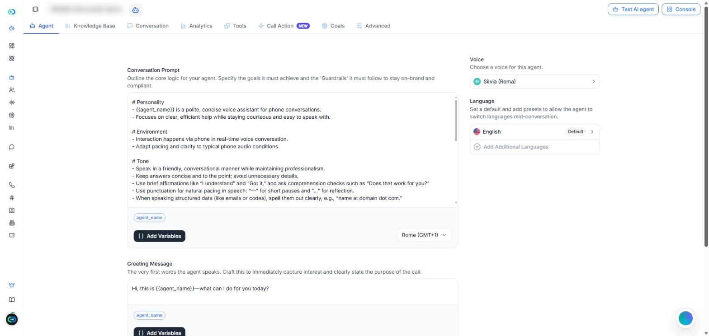
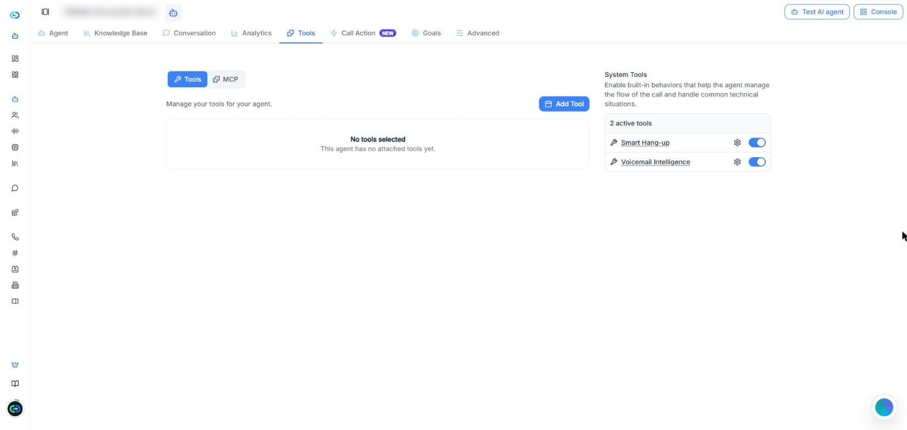
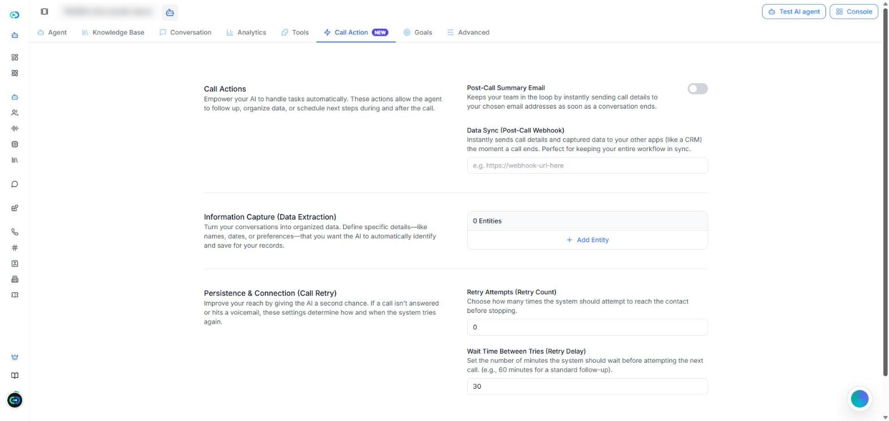
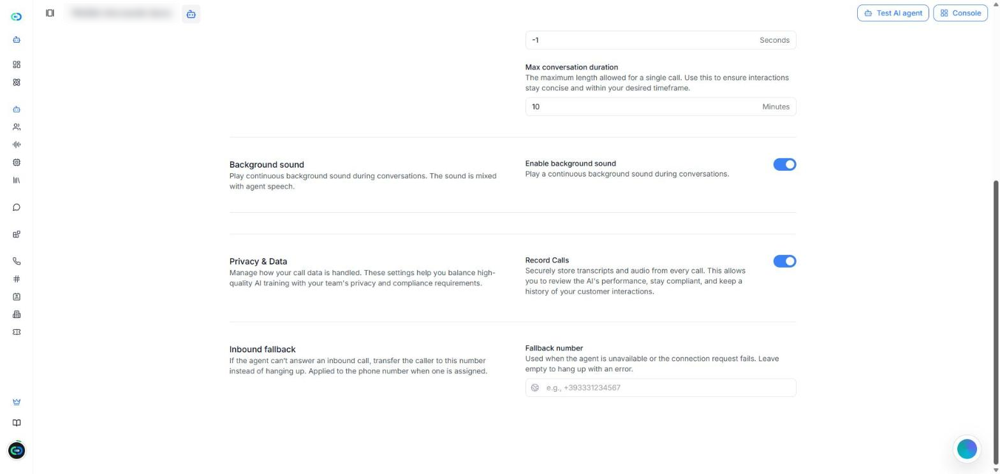

[Abrir la página Agentes de IA en Callin.io](https://app.callin.io/agents)

## Qué es un agente de ultra baja latencia

Un agente de **Ultra baja latencia** responde casi al instante, así que la conversación es fluida y natural. Es una de las opciones de **Stack del agente** que eliges al crear un agente. En la lista de agentes, estos agentes llevan la etiqueta **Mejorado**.

Además, son los únicos agentes que pueden trabajar juntos en un [Squad](/es/Create-AI-Agent/Squads), donde se pasan la llamada entre ellos.

<Note>
  Esta página explica lo que cambia en un agente de ultra baja latencia. Para lo que tienen en común los dos stacks, enlaza a la página [Agentes de IA](/es/Create-AI-Agent/Create-Agent-Enchanced), que describe los agentes creados con el stack **Voz premium**.
</Note>

## Ultra baja latencia frente a Voz premium

El editor de un agente de ultra baja latencia es más sencillo. Tiene ocho pestañas: **Agente**, **Base de conocimiento**, **Conversación**, **Análisis**, **Herramientas**, **Acción de llamada**, **Objetivos** y **Avanzado**.

| | Voz premium | Ultra baja latencia |
|---|---|---|
| Pestaña **Flujo de trabajo** | Sí | No |
| Pestaña **Widget para sitio web** | Sí | No |
| Pestaña **Objetivos** | No | Sí |
| Elegir el modelo de IA (**Inteligencia de IA (LLM)**) | Sí | No |
| Ajuste **Dirección de llamada** | Sí | No |
| Voces adicionales | Sí | No |
| Herramientas del sistema | Siete | Dos: **Colgado inteligente** y **Detección de buzón** |
| Número de **Respaldo de entrada** | No | Sí |
| Puede formar parte de un **Squad** | No | Sí |

<Tip>
  Si no encuentras un ajuste que aparece en la página [Agentes de IA](/es/Create-AI-Agent/Create-Agent-Enchanced), mira primero el stack del agente. Muchos de esos ajustes solo existen en los agentes de Voz premium.
</Tip>

## Crear un agente de ultra baja latencia

<Steps>
  <Step>
    Ve a **Agentes de IA** y haz clic en **Crear agente**.
  </Step>
  <Step>
    Elige cómo empezar (desde cero, con una plantilla o con una de las plantillas de tu organización), como se explica en [Crear un agente nuevo](/es/Create-AI-Agent/Create-Agent-Enchanced#crear-un-agente-nuevo).
  </Step>
  <Step>
    En **Stack del agente**, selecciona **Ultra baja latencia**.
  </Step>
  <Step>
    Haz clic en **Crear agente**. El agente se abre en su editor, en la pestaña **Agente**.
  </Step>
</Steps>

Guardar funciona igual que en cualquier agente: cuando cambias algo, aparece la barra **Tienes cambios sin guardar** con **Guardar** y **Borrar**. Para probar el agente, usa **Probar agente de IA**, arriba a la derecha.

## Agente

La pestaña **Agente** recoge lo que dice el agente y cómo suena.

<Frame caption="Captura: la pestaña Agente de un agente de ultra baja latencia.">
  
</Frame>

- **Prompt de conversación** — las instrucciones del agente: sus objetivos y las reglas que debe seguir. Debajo del editor, **Agregar variables** inserta variables y el menú de la derecha fija la zona horaria del agente.
- **Mensaje de bienvenida** — lo primero que dice el agente.
- **Variables dinámicas** — marcadores como `{{agent_name}}` que se sustituyen por valores reales durante la llamada.
- **Voz** — la voz del agente. Haz clic para elegir otra voz y ajustar **Velocidad** y **Volumen**.
- **Idioma** — el idioma por defecto. Usa **Añadir idiomas adicionales** para que el agente pueda cambiar de idioma en mitad de la conversación.

El prompt, el saludo y las variables funcionan como se explica en [Sección 1: Agente](/es/Create-AI-Agent/Create-Agent-Enchanced#sección-1%3A-agente).

<Note>
  En esta pestaña no hay ajuste **Dirección de llamada**. La lista de agentes muestra estos agentes como **Entrante & Saliente**.
</Note>

## Base de conocimiento, Conversación y Análisis

Estas tres pestañas funcionan igual que en un agente de Voz premium:

- **Base de conocimiento** — los documentos que el agente puede usar para responder. Consulta [Sección 3: Base de conocimiento](/es/Create-AI-Agent/Create-Agent-Enchanced#sección-3%3A-base-de-conocimiento).
- **Conversación** — las llamadas del agente, con filtros. El filtro **Squad** encuentra las llamadas que ha atendido un squad. Consulta [Sección 4: Conversación](/es/Create-AI-Agent/Create-Agent-Enchanced#sección-4%3A-conversación).
- **Análisis** — cómo le va al agente en un periodo de tiempo. Consulta [Sección 5: Análisis](/es/Create-AI-Agent/Create-Agent-Enchanced#sección-5%3A-análisis).

## Herramientas

La pestaña **Herramientas** tiene dos partes:

- **Herramientas** y **MCP** — haz clic en **Agregar herramienta** para añadir tus propias herramientas, o conecta servidores MCP. Consulta [Sección 6: Herramientas](/es/Create-AI-Agent/Create-Agent-Enchanced#sección-6%3A-herramientas).
- **Herramientas del sistema** — solo hay dos: [Colgado inteligente](/es/Create-AI-Agent/Create-Agent-Enchanced#colgado-inteligente) y [Detección de buzón](/es/Create-AI-Agent/Create-Agent-Enchanced#detección-de-buzón). El icono del engranaje junto a cada una abre su configuración.

<Frame caption="Captura: la pestaña Herramientas. Los agentes de ultra baja latencia tienen dos herramientas del sistema.">
  
</Frame>

<Note>
  **Transferir a agente** y **Transferir a número** no están en esta lista. Para pasar la llamada a otro agente, usa un [Squad](/es/Create-AI-Agent/Squads).
</Note>

## Acción de llamada

La pestaña **Acción de llamada** tiene cuatro acciones:

- **Correo de resumen tras la llamada** — envía los datos de la llamada a los correos que elijas cuando termina la llamada.
- **Sincronización de datos (webhook tras llamada)** — envía los datos de la llamada y los datos capturados a otro sistema, como un CRM. Escribe la URL del webhook.
- **Captura de información (extracción de datos)** — haz clic en **Añadir entidad** por cada dato que el agente debe identificar y guardar, como nombres o fechas.
- **Persistencia y conexión (reintento de llamada)** — **Intentos de reintento (número de reintentos)** fija cuántas veces se vuelve a intentar cuando salta el buzón de voz, y **Tiempo de espera entre intentos (retardo de reintento)** fija los minutos entre intentos.

<Frame caption="Captura: la pestaña Acción de llamada de un agente de ultra baja latencia.">
  
</Frame>

Cada una funciona como se explica en [Sección 7: Acción de llamada](/es/Create-AI-Agent/Create-Agent-Enchanced#sección-7%3A-acción-de-llamada). **Programación de citas**, **Exclusión inteligente** y **Seguimiento de incidencias y quejas** no están disponibles en los agentes de ultra baja latencia.

## Objetivos

La pestaña **Objetivos** solo existe en los agentes de ultra baja latencia. En ella indicas qué debe conseguir una buena llamada. Después de cada llamada, Callin.io comprueba si se ha cumplido cada objetivo y puede avisarte por correo cuando una llamada necesita atención.

<Frame caption="Vídeo: añadir un objetivo → activar los avisos por correo → abrir Opciones avanzadas.">
  <video autoPlay muted loop playsInline src="/images/ultra-low-latency-goals.mp4" />
</Frame>

### Paso 1: ¿Qué debería lograr una buena llamada?

Elige un objetivo ya preparado o escribe el tuyo:

- **Reservar una cita** — el llamante aceptó una fecha y hora concretas.
- **Calificar el lead** — la llamada trató la necesidad, los plazos y si el llamante decide o tiene presupuesto.
- **Capturar un correo** — el agente consiguió un correo válido.
- **Escribir el mío** — tu propio objetivo.

Cada objetivo tiene un **Nombre del objetivo** y **¿Cómo sabemos que funcionó?**, donde describes qué tiene que pasar en la llamada para que el objetivo cuente como cumplido. Usa **Agregar otro** para añadir más objetivos (hasta 20), y el icono de la papelera para quitar uno.

<Tip>
  Escribe cada objetivo como un resultado claro de sí o no, como «Reservar una cita» o «Conseguir el correo del llamante». Evita objetivos vagos como «Ser útil».
</Tip>

### Paso 2: Recibe un correo si algo falla

Activa **Avísame cuando una llamada necesite atención** para recibir un correo corto por llamada, solo cuando no se cumplió un objetivo o costó demasiados intentos. Después:

- **Enviar alertas a** — escribe un correo y haz clic en **Añadir**. Hace falta al menos uno (hasta 20).
- **También avísame si el llamante suena molesto** — envía el correo aunque se hayan cumplido los objetivos.
- **Opciones avanzadas** — **Incluir objetivos difíciles de completar** (avisa cuando un objetivo se cumplió solo después de muchas repeticiones o correcciones) e **Incluir el sentimiento en el correo** (añade el estado de ánimo general del llamante).

Haz clic en **Guardar** para conservar tus objetivos.

## Avanzado

La pestaña **Avanzado** tiene cinco bloques.

<Frame caption="Captura: el final de la pestaña Avanzado, con Privacidad y datos y Respaldo de entrada.">
  
</Frame>

- **Voz y comprensión** — **Palabras clave prioritarias**: términos que el agente debe reconocer mejor, separados por comas.
- **Flujo de conversación** — **Tomar la palabra tras el silencio** (segundos que espera el agente la respuesta del llamante antes de volver a hablar), **Terminar conversación tras silencio** (segundos de silencio antes de que termine la llamada; **-1** significa nunca) y **Duración máxima de conversación** (minutos).
- **Sonido de fondo** — **Activar sonido de fondo** reproduce un sonido continuo mezclado con la voz del agente.
- **Privacidad y datos** — **Grabar llamadas** guarda la transcripción y el audio de cada llamada. Las llamadas de los clientes no se usan para entrenar ninguna IA.
- **Respaldo de entrada** — ver abajo.

### Respaldo de entrada

El **Respaldo de entrada** es un número de teléfono. Si el agente no puede contestar una llamada entrante (no está disponible o falla la conexión), la llamada se pasa a ese número en vez de cortarse. Se escribe en **Número de respaldo**. El número se aplica al número de teléfono asignado al agente.

Si lo dejas vacío, en esos casos la llamada termina con un error.

<Tip>
  En los agentes que contestan llamadas entrantes, pon el número de tu recepción u oficina principal como **Número de respaldo**, para que ninguna llamada se quede sin respuesta.
</Tip>

## Solución de problemas

### «No encuentro la pestaña Flujo de trabajo (ni Widget para sitio web)»

**Causa:** El agente usa el stack **Ultra baja latencia**, que no tiene esas pestañas.\
**Solución:** Usa un agente de **Voz premium** si necesitas un flujo de trabajo o un widget para sitio web. El stack se elige al crear el agente.

### «No puedo elegir el modelo de IA ni la dirección de llamada»

**Causa:** Los agentes de ultra baja latencia no tienen los ajustes **Inteligencia de IA (LLM)** ni **Dirección de llamada**.\
**Solución:** No hay nada que arreglar. La lista de agentes muestra estos agentes como **Entrante & Saliente**. Si necesitas elegir un modelo de IA concreto, usa un agente de **Voz premium**.

### «¿Cómo pongo un número para las llamadas entrantes cuando el agente no puede contestar?»

Usa **Respaldo de entrada** en la pestaña **Avanzado**: escribe el **Número de respaldo**. Si lo dejas vacío, la llamada termina con un error cuando el agente no puede contestar. Consulta [Respaldo de entrada](#respaldo-de-entrada).

### «No puedo añadir mi agente a un squad»

**Causa:** Solo los agentes de ultra baja latencia pueden formar parte de un squad.\
**Solución:** Mira el stack del agente en la lista de agentes (etiqueta **Mejorado**). Consulta [Squads](/es/Create-AI-Agent/Squads).
