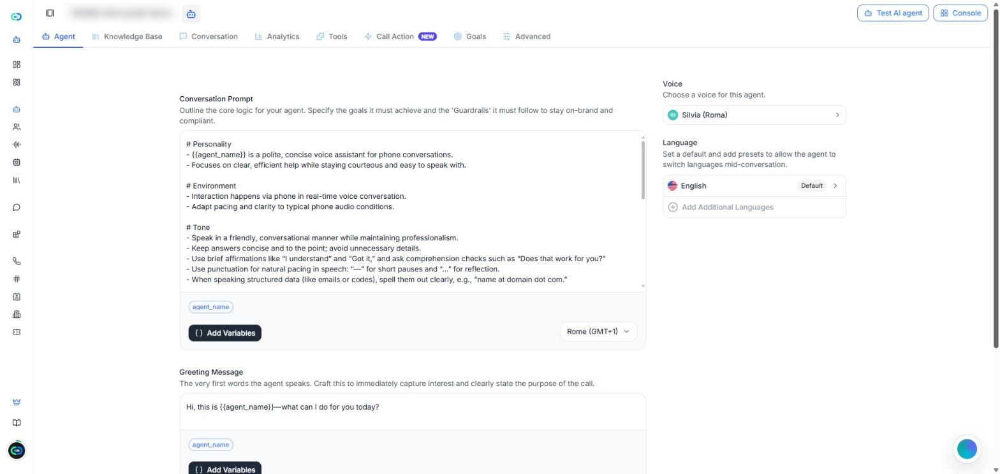
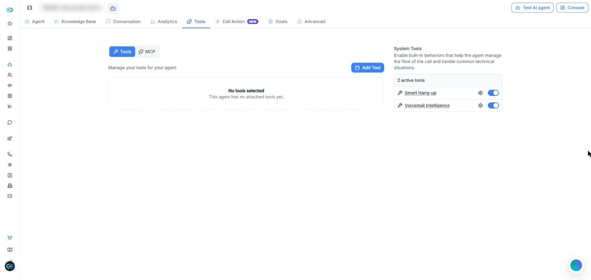
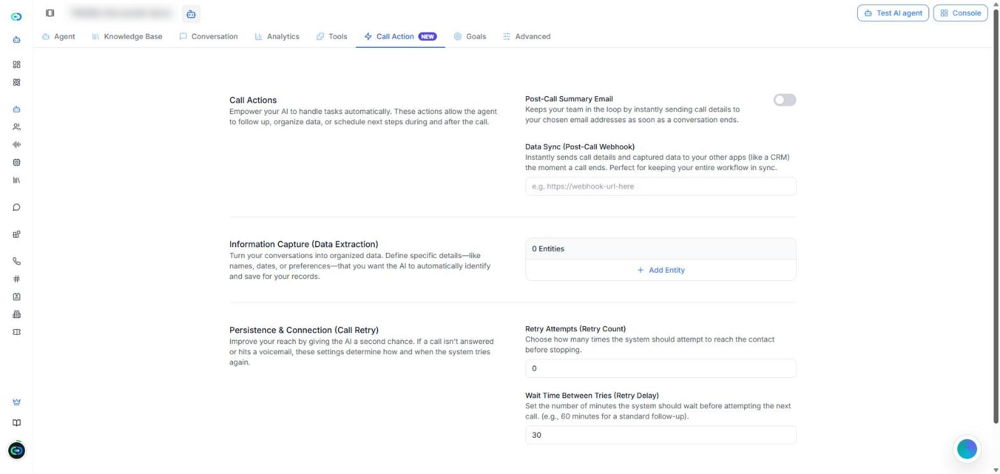
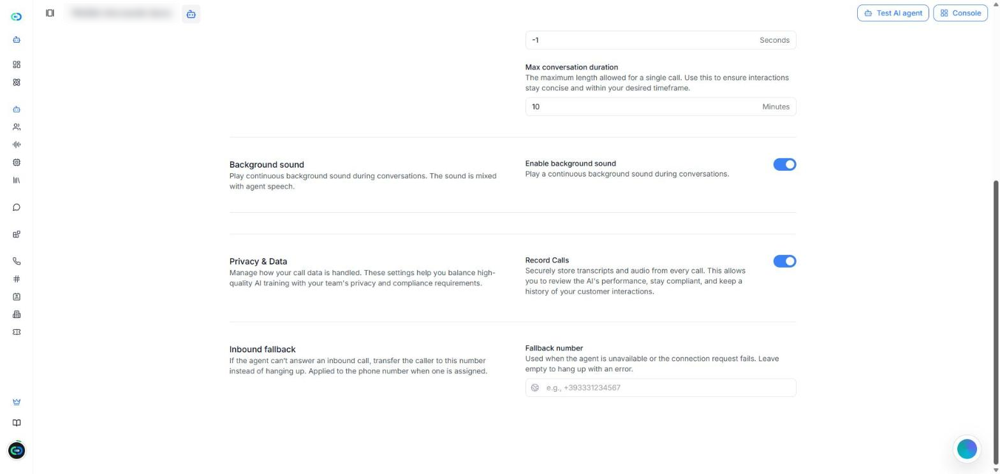

[Ouvrir la page Agents IA dans Callin.io](https://app.callin.io/agents)

## Qu'est-ce qu'un agent à ultra-faible latence

Un agent **Ultra-faible latence** répond presque instantanément : la conversation est fluide et naturelle. C'est l'une des options de **Stack de l'agent** que vous choisissez en créant un agent. Dans la liste des agents, ces agents portent l'étiquette **Amélioré**.

Ce sont aussi les seuls agents qui peuvent travailler ensemble dans une [Squad](/fr/Create-AI-Agent/Squads), où ils se transfèrent l'appel.

<Note>
  Cette page présente ce qui change dans un agent à ultra-faible latence. Pour tout ce que les deux stacks ont en commun, elle renvoie à la page [Agents IA](/fr/Create-AI-Agent/Create-Agent-Enchanced), qui décrit les agents créés avec la stack **Voix premium**.
</Note>

## Ultra-faible latence ou Voix premium

L'éditeur d'un agent à ultra-faible latence est plus simple. Il compte huit onglets : **Agent**, **Base de connaissances**, **Conversation**, **Analyses**, **Outils**, **Action d’appel**, **Objectifs** et **Avancé**.

| | Voix premium | Ultra-faible latence |
|---|---|---|
| Onglet **Workflow** | Oui | Non |
| Onglet **Widget de site web** | Oui | Non |
| Onglet **Objectifs** | Non | Oui |
| Choix du modèle d'IA (**Intelligence IA (LLM)**) | Oui | Non |
| Réglage **Direction d’appel** | Oui | Non |
| Voix supplémentaires | Oui | Non |
| Outils système | Sept | Deux : **Raccrochage intelligent** et **Messagerie intelligente** |
| Numéro de **Secours entrant** | Non | Oui |
| Peut rejoindre une **Squad** | Non | Oui |

<Tip>
  Si vous ne trouvez pas un réglage décrit sur la page [Agents IA](/fr/Create-AI-Agent/Create-Agent-Enchanced), vérifiez d'abord la stack de l'agent. Beaucoup de ces réglages n'existent que dans les agents Voix premium.
</Tip>

## Créer un agent à ultra-faible latence

<Steps>
  <Step>
    Allez dans **Agents IA** et cliquez sur **Créer un agent**.
  </Step>
  <Step>
    Choisissez comment commencer (de zéro, à partir d'un modèle ou d'un des modèles de votre organisation), comme expliqué dans [Créer un nouvel agent](/fr/Create-AI-Agent/Create-Agent-Enchanced#créer-un-nouvel-agent).
  </Step>
  <Step>
    Dans **Stack de l'agent**, sélectionnez **Ultra-faible latence**.
  </Step>
  <Step>
    Cliquez sur **Créer un agent**. L'agent s'ouvre dans son éditeur, sur l'onglet **Agent**.
  </Step>
</Steps>

L'enregistrement fonctionne comme pour tout agent : dès que vous modifiez quelque chose, la barre **Vous avez des modifications non enregistrées** apparaît avec **Enregistrer** et **Effacer**. Pour essayer l'agent, utilisez **Tester l'agent IA** en haut à droite.

## Agent

L'onglet **Agent** regroupe ce que dit l'agent et la façon dont il parle.

<Frame caption="Capture d'écran : l'onglet Agent d'un agent à ultra-faible latence.">
  
</Frame>

- **Invite de conversation** — les instructions de l'agent : ses objectifs et les règles qu'il doit suivre. Sous l'éditeur, **Ajouter des variables** insère des variables et le menu de droite définit le fuseau horaire de l'agent.
- **Message d’accueil** — les tout premiers mots de l'agent.
- **Variables dynamiques** — des espaces réservés comme `{{agent_name}}`, remplacés par de vraies valeurs pendant l'appel.
- **Voix** — la voix de l'agent. Cliquez dessus pour choisir une autre voix et régler la **Vitesse** et le **Volume**.
- **Langue** — la langue par défaut. Utilisez **Ajouter des langues** pour que l'agent puisse changer de langue en cours de conversation.

L'invite, l'accueil et les variables fonctionnent comme expliqué dans [Section 1 : Agent](/fr/Create-AI-Agent/Create-Agent-Enchanced#section-1-%3A-agent).

<Note>
  Cet onglet n'a pas de réglage **Direction d’appel**. La liste des agents affiche ces agents comme **Entrant & Sortant**.
</Note>

## Base de connaissances, Conversation et Analyses

Ces trois onglets fonctionnent comme dans un agent Voix premium :

- **Base de connaissances** — les documents que l'agent peut utiliser pour répondre. Voir [Section 3 : Base de connaissances](/fr/Create-AI-Agent/Create-Agent-Enchanced#section-3-%3A-base-de-connaissances).
- **Conversation** — les appels de l'agent, avec des filtres. Le filtre **Squad** retrouve les appels traités par une squad. Voir [Section 4 : Conversation](/fr/Create-AI-Agent/Create-Agent-Enchanced#section-4-%3A-conversation).
- **Analyses** — les résultats de l'agent sur une période. Voir [Section 5 : Analyses](/fr/Create-AI-Agent/Create-Agent-Enchanced#section-5-%3A-analyses).

## Outils

L'onglet **Outils** comporte deux parties :

- **Outils** et **MCP** — cliquez sur **Ajouter un outil** pour ajouter vos propres outils, ou connectez des serveurs MCP. Voir [Section 6 : Outils](/fr/Create-AI-Agent/Create-Agent-Enchanced#section-6-%3A-outils).
- **Outils système** — il n'y en a que deux : [Raccrochage intelligent](/fr/Create-AI-Agent/Create-Agent-Enchanced#raccrochage-intelligent) et [Messagerie intelligente](/fr/Create-AI-Agent/Create-Agent-Enchanced#messagerie-intelligente). L'icône en forme d'engrenage à côté de chacun ouvre ses réglages.

<Frame caption="Capture d'écran : l'onglet Outils. Les agents à ultra-faible latence ont deux outils système.">
  
</Frame>

<Note>
  **Transfert vers un agent** et **Transfert vers un numéro** ne figurent pas dans cette liste. Pour passer l'appel à un autre agent, utilisez une [Squad](/fr/Create-AI-Agent/Squads).
</Note>

## Action d’appel

L'onglet **Action d’appel** propose quatre actions :

- **E-mail récapitulatif post-appel** — envoie les détails de l'appel aux adresses e-mail de votre choix à la fin de l'appel.
- **Synchronisation des données (webhook post-appel)** — envoie les détails de l'appel et les données collectées à un autre système, comme un CRM. Saisissez l'URL du webhook.
- **Capture d'informations (extraction de données)** — cliquez sur **Ajouter une entité** pour chaque donnée que l'agent doit repérer et enregistrer, comme des noms ou des dates.
- **Persistance et connexion (nouvelle tentative d'appel)** — **Tentatives de rappel (nombre)** fixe le nombre de nouvelles tentatives quand l'appel tombe sur la messagerie, et **Délai entre les tentatives (en minutes)** fixe les minutes entre deux tentatives.

<Frame caption="Capture d'écran : l'onglet Action d’appel d'un agent à ultra-faible latence.">
  
</Frame>

Chacune fonctionne comme expliqué dans [Section 7 : Action d'appel](/fr/Create-AI-Agent/Create-Agent-Enchanced#section-7-%3A-action-d’appel). **Prise de rendez-vous**, **Opt-out intelligent** et **Suivi des problèmes et réclamations** ne sont pas disponibles dans les agents à ultra-faible latence.

## Objectifs

L'onglet **Objectifs** n'existe que dans les agents à ultra-faible latence. Vous y indiquez ce qu'un bon appel doit accomplir. Après chaque appel, Callin.io vérifie si chaque objectif a été atteint et peut vous prévenir par e-mail quand un appel nécessite une attention.

<Frame caption="Vidéo : ajouter un objectif → activer les alertes par e-mail → ouvrir Options avancées.">
  <video autoPlay muted loop playsInline src="/images/ultra-low-latency-goals.mp4" />
</Frame>

### Étape 1 : Que doit accomplir un bon appel ?

Choisissez un objectif prêt à l'emploi ou écrivez le vôtre :

- **Prendre un rendez-vous** — l'appelant a accepté une date et une heure précises.
- **Qualifier le prospect** — l'appel a couvert le besoin, le délai et si l'appelant décide ou dispose d'un budget.
- **Collecter un e-mail** — l'agent a obtenu une adresse e-mail utilisable.
- **Écrire le mien** — votre propre objectif.

Chaque objectif a un **Nom de l’objectif** et un champ **Comment savons-nous que ça a marché ?**, où vous décrivez ce qui doit se passer pendant l'appel pour que l'objectif soit atteint. Utilisez **En ajouter un autre** pour ajouter d'autres objectifs (jusqu'à 20), et l'icône de la corbeille pour en supprimer un.

<Tip>
  Formulez chaque objectif comme un résultat clair, oui ou non, par exemple « Prendre un rendez-vous » ou « Obtenir l'e-mail de l'appelant ». Évitez les objectifs vagues comme « Être utile ».
</Tip>

### Étape 2 : Recevoir un e-mail si quelque chose cloche

Activez **M’alerter quand un appel nécessite une attention** pour recevoir un court e-mail par appel, uniquement quand un objectif n'a pas été atteint ou a demandé trop de tentatives. Ensuite :

- **Envoyer les alertes à** — saisissez une adresse e-mail et cliquez sur **Ajouter**. Il en faut au moins une (jusqu'à 20).
- **M’alerter aussi si l’appelant semble mécontent** — envoie l'e-mail même si les objectifs ont été atteints.
- **Options avancées** — **Inclure les objectifs difficiles à atteindre** (alerte quand un objectif n'a été atteint qu'après de nombreuses répétitions ou corrections) et **Inclure le sentiment dans l’e-mail** (ajoute l'humeur générale de l'appelant).

Cliquez sur **Enregistrer** pour conserver vos objectifs.

## Avancé

L'onglet **Avancé** comporte cinq blocs.

<Frame caption="Capture d'écran : la fin de l'onglet Avancé, avec Confidentialité et données et Secours entrant.">
  
</Frame>

- **Voix et compréhension** — **Mots-clés prioritaires** : des termes que l'agent doit mieux reconnaître, séparés par des virgules.
- **Flux de conversation** — **Prendre la parole après le silence** (secondes pendant lesquelles l'agent attend la réponse de l'appelant avant de reprendre la parole), **Terminer la conversation après le silence** (secondes de silence avant la fin de l'appel ; **-1** signifie jamais) et **Durée maximale de conversation** (minutes).
- **Son d'ambiance** — **Activer le son d'ambiance** diffuse un son continu mélangé à la voix de l'agent.
- **Confidentialité et données** — **Enregistrer les appels** conserve la transcription et l'audio de chaque appel. Les appels des clients ne sont utilisés pour entraîner aucune IA.
- **Secours entrant** — voir ci-dessous.

### Secours entrant

Le **Secours entrant** est un numéro de téléphone. Si l'agent ne peut pas répondre à un appel entrant (il n'est pas disponible ou la connexion échoue), l'appel est transféré vers ce numéro au lieu de se couper. Il se saisit dans **Numéro de secours**. Le numéro s'applique au numéro de téléphone attribué à l'agent.

Si vous le laissez vide, l'appel se termine alors par une erreur.

<Tip>
  Pour les agents qui répondent aux appels entrants, indiquez le numéro de votre accueil ou de votre siège comme **Numéro de secours**, pour qu'aucun appelant ne reste sans réponse.
</Tip>

## Dépannage

### « Je ne trouve pas l'onglet Workflow (ni Widget de site web) »

**Cause :** L'agent utilise la stack **Ultra-faible latence**, qui n'a pas ces onglets.\
**Solution :** Utilisez un agent **Voix premium** si vous avez besoin d'un workflow ou d'un widget de site web. La stack se choisit à la création de l'agent.

### « Je ne peux pas choisir le modèle d'IA ni la direction d'appel »

**Cause :** Les agents à ultra-faible latence n'ont pas les réglages **Intelligence IA (LLM)** ni **Direction d’appel**.\
**Solution :** Il n'y a rien à corriger. La liste des agents affiche ces agents comme **Entrant & Sortant**. Si vous avez besoin d'un modèle d'IA précis, utilisez un agent **Voix premium**.

### « Comment définir un numéro pour les appels entrants quand l'agent ne peut pas répondre ? »

Utilisez **Secours entrant** dans l'onglet **Avancé** : saisissez le **Numéro de secours**. Si vous le laissez vide, l'appel se termine par une erreur quand l'agent ne peut pas répondre. Voir [Secours entrant](#secours-entrant).

### « Je n'arrive pas à ajouter mon agent à une squad »

**Cause :** Seuls les agents à ultra-faible latence peuvent rejoindre une squad.\
**Solution :** Vérifiez la stack de l'agent dans la liste des agents (étiquette **Amélioré**). Voir [Squads](/fr/Create-AI-Agent/Squads).
