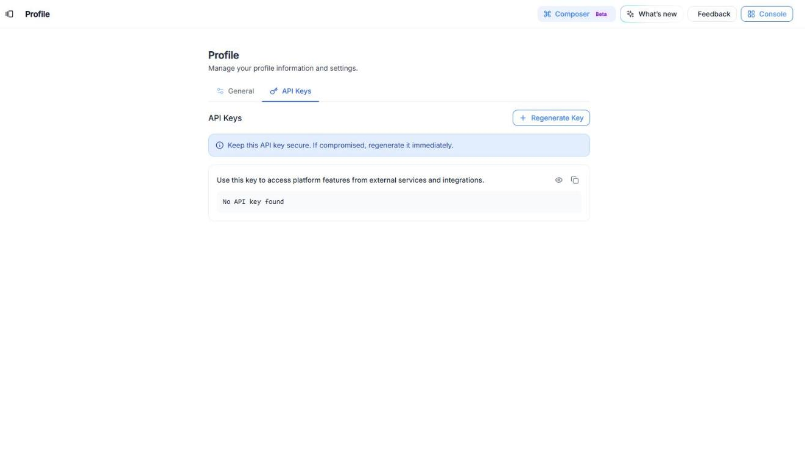
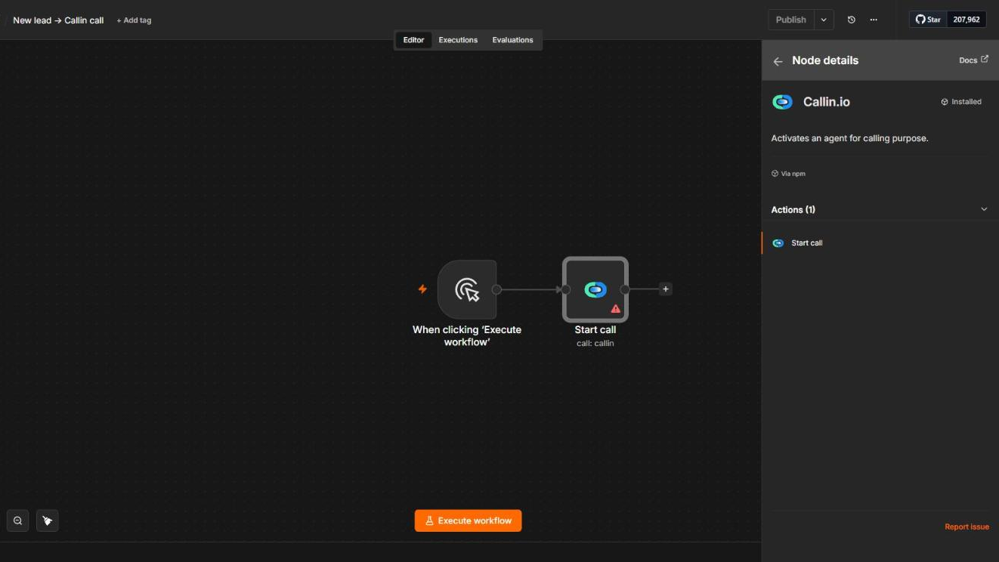
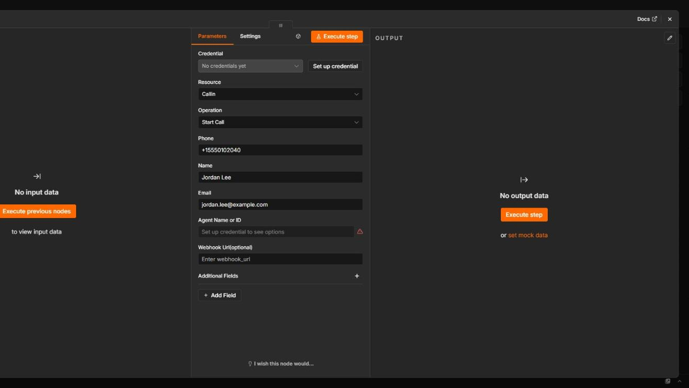

## Panoramica

Crea potenti automazioni tra Callin.io e i tuoi strumenti preferiti con n8n. Callin.io ti offre il tuo spazio n8n su **n8n.callin.io**, con un nodo **Callin.io** già pronto per far avviare chiamate ai tuoi agenti AI.

<Frame caption="Video: Integrazioni → Vai a n8n → accesso → aggiungi il nodo Callin.io → Avvia chiamata → configura la credenziale con la chiave API del profilo.">
  <video autoPlay muted loop playsInline src="/images/n8n-connect.mp4" />
</Frame>

<Note>
  L’interfaccia di n8n è in inglese. In questa guida trovi il nome inglese in grassetto, con la traduzione tra parentesi.
</Note>

## Passaggi

### Passaggio 1: Cos’è n8n e perché usarlo con Callin.io?

n8n è uno strumento di automazione che collega app diverse perché lavorino insieme senza intoppi.

Con Callin.io, questa integrazione ti permette di:

- **Avviare chiamate in uscita a partire da eventi esterni**: ad esempio quando arriva un nuovo lead nel CRM, quando qualcuno compila un modulo sul tuo sito o a un orario programmato. Il nodo **Callin.io** ha un’unica azione, **Start call** (Avvia chiamata), che fa chiamare un contatto da uno dei tuoi agenti AI.
- **Ricevere i dati delle chiamate in n8n**: invia i dettagli di ogni chiamata conclusa a un flusso n8n con la **Sincronizzazione dati (webhook post-chiamata)** dell’agente (nella scheda **Azione chiamata**), e da lì a Slack, Google Sheets, il tuo CRM, ecc.

In breve: n8n trasforma gli eventi dei tuoi altri strumenti in chiamate, e le chiamate in azioni nei tuoi altri strumenti.

<Warning>
  Il nodo **Callin.io** non ha attivatori propri. Per avviare un flusso usa un attivatore di n8n (ad esempio **On a Webhook call** (Alla ricezione di una chiamata webhook), **On a Schedule** (Secondo una pianificazione) o un attivatore del tuo CRM) e poi aggiungi il nodo **Callin.io**.
</Warning>

### Passaggio 2: Accedi al pannello integrazioni di Callin.io

<Steps>
  <Step>
    Accedi al tuo account Callin.io.
  </Step>
  <Step>
    Nel menu a sinistra, clicca su **Integrazioni → Azioni** ([aprilo qui](https://app.callin.io/actions)).
  </Step>
  <Step>
    Usa il filtro **Automazione** (o cerca in **Tutte**).
  </Step>
  <Step>
    Trova la scheda **N8N** e clicca su **Vai a n8n**.
  </Step>
</Steps>

### Passaggio 3: Accedi al tuo account n8n

<Steps>
  <Step>
    Si apre una nuova scheda su **n8n.callin.io**.
  </Step>
  <Step>
    Inserisci **Email** e **Password** di n8n e clicca su **Sign in** (Accedi).
  </Step>
  <Step>
    Se non hai ancora accesso, contatta l’amministratore del tuo account Callin.io.
  </Step>
</Steps>

Una volta dentro, vedrai la schermata **Overview** (Panoramica) di n8n con i tuoi flussi e il pulsante **Create workflow** (Crea flusso di lavoro).

### Passaggio 4: Ottieni la tua chiave API di Callin.io

Il nodo **Callin.io** ha bisogno di una chiave API per agire sul tuo account.

<Steps>
  <Step>
    In Callin.io, apri il tuo profilo ([app.callin.io/profile](https://app.callin.io/profile)) e vai alla scheda **API Keys** (Chiavi API).
  </Step>
  <Step>
    Se non hai ancora una chiave (“Nessuna chiave API trovata”), clicca su **Regenerate Key** (Rigenera chiave) per crearla.
  </Step>
  <Step>
    Usa l’icona di copia per copiare la chiave.
  </Step>
</Steps>

<Frame caption="Schermata: Profilo → Chiavi API, dove crei e copi la tua chiave API.">
  
</Frame>

<Warning>
  Mantieni questa chiave API al sicuro. Se clicchi su **Regenerate Key** (Rigenera chiave) quando ne hai già una, la vecchia smette di funzionare e dovrai aggiornare con la nuova chiave tutti i flussi che la usano.
</Warning>

### Passaggio 5: Crea la tua prima automazione

<Steps>
  <Step>
    In n8n, clicca su **Create workflow** (Crea flusso di lavoro).
  </Step>
  <Step>
    Aggiungi un attivatore che avvii il flusso (ad esempio **On a Webhook call** (Alla ricezione di una chiamata webhook) per ricevere un nuovo lead dal tuo sito o dal CRM).
  </Step>
  <Step>
    Clicca su **+** per aggiungere il passo successivo, cerca **Callin.io** e scegli l’azione **Avvia chiamata**.
  </Step>
</Steps>

<Frame caption="Schermata: il nodo Callin.io in n8n, con la sua azione Avvia chiamata.">
  
</Frame>

In **Credential** (Credenziale), clicca su **Set up credential** (Configura credenziale), incolla la tua **Api Key** (Chiave API) di Callin.io e clicca su **Salva**.

Poi compila i campi di **Start call** (Avvia chiamata):

- **Phone** (Telefono): il numero che l’agente chiamerà.
- **Nome**: il nome del contatto.
- **Email**: l’email del contatto.
- **Agent Name or ID** (Nome o ID dell’agente): l’agente che farà la chiamata (l’elenco compare dopo aver configurato la credenziale).
- **Webhook Url (optional)** (URL del webhook (facoltativo)): un URL a cui inviare i dati della chiamata.
- **Additional Fields** (Campi aggiuntivi): clicca su **Add Field** (Aggiungi campo) per inviare dati extra come coppie **Field Name** (Nome campo) / **Field Value** (Valore campo).

<Frame caption="Schermata: i parametri di Avvia chiamata, compilati con un contatto di esempio.">
  
</Frame>

<Tip>
  Invece di scrivere valori fissi, usa le espressioni di n8n per prendere i dati dal passo precedente (ad esempio `{{ $json.phone }}` per il telefono inviato dal tuo modulo o dal CRM).
</Tip>

### Passaggio 6: Attiva e testa

<Steps>
  <Step>
    Clicca su **Execute step** (Esegui passo) (o **Execute workflow** (Esegui flusso di lavoro)) per fare una chiamata di prova a un numero reale che controlli.
  </Step>
  <Step>
    Quando tutto funziona, clicca su **Publish** (Pubblica) perché il flusso venga eseguito automaticamente.
  </Step>
</Steps>

## Suggerimenti e note

- **Usa i tuoi dati**: con le espressioni di n8n passi i valori dell’attivatore (nome, telefono, email) ai campi di **Start call** (Avvia chiamata).
- **Logica condizionale**: aggiungi nodi **IF** (Se) o **Switch** (Selettore) per automazioni più complesse (ad esempio chiamare solo i lead di un certo paese).
- **Ricevi i risultati delle chiamate**: incolla l’URL di un attivatore **On a Webhook call** (Alla ricezione di una chiamata webhook) di n8n nella **Sincronizzazione dati (webhook post-chiamata)** dell’agente per ricevere in n8n i dettagli di ogni chiamata conclusa.
- **Flussi concatenati**: combina Callin.io con CRM e strumenti di messaggistica in un unico processo continuo.

## Risoluzione dei problemi

**Sintomo:** L’elenco **Agent Name or ID** (Nome o ID dell’agente) è vuoto\
**Causa probabile:** La credenziale non è configurata o la chiave API è errata. Configura di nuovo la credenziale con una chiave valida da **Profile → API Keys** (Profilo → Chiavi API).

**Sintomo:** Ha smesso di funzionare dopo un cambio di chiave\
**Causa probabile:** La chiave API è stata rigenerata. Aggiorna la credenziale in n8n con la nuova chiave.

**Sintomo:** Il flusso non si avvia\
**Causa probabile:** Verifica che il flusso sia pubblicato e che il suo attivatore stia ricevendo dati.

**Sintomo:** La chiamata non parte\
**Causa probabile:** Verifica che **Phone** (Telefono) contenga un numero valido in formato internazionale (ad esempio `+393339876543`) e che all’agente sia assegnato un numero di telefono.

## Nota finale

Inizia in piccolo, ad esempio chiamando ogni nuovo lead che arriva dal modulo del tuo sito, e aggiungi altri flussi quando il primo funziona.
