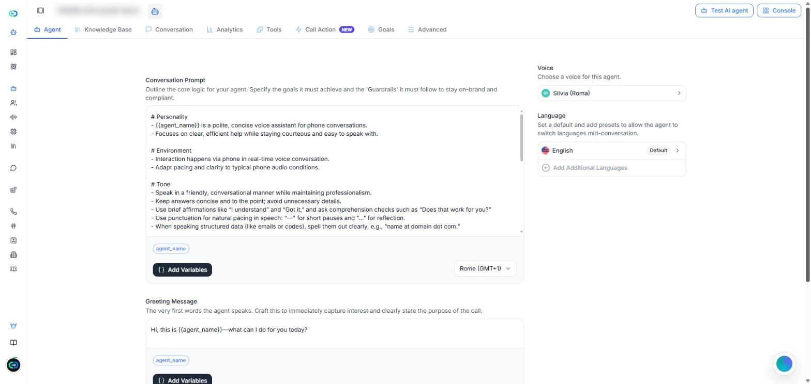
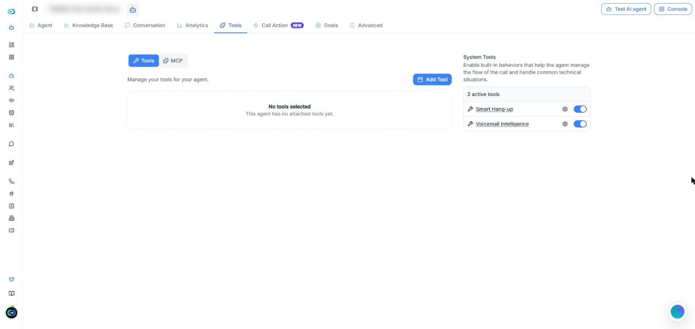
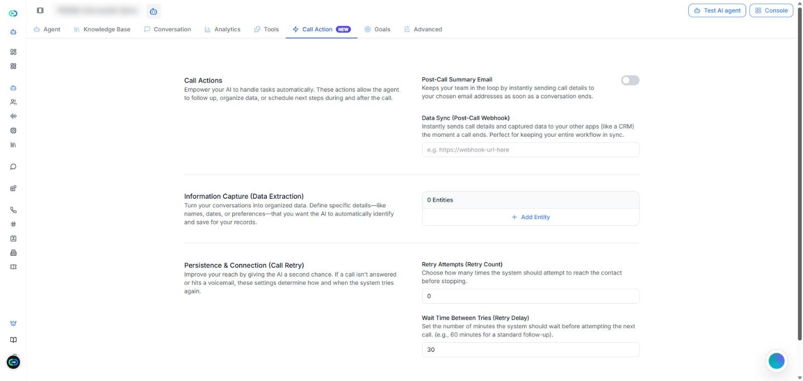
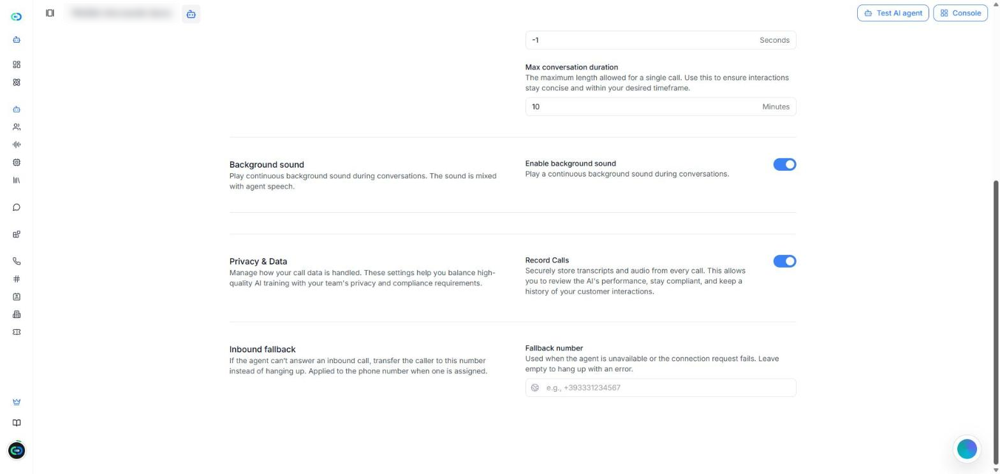

[Apri la pagina Agenti AI in Callin.io](https://app.callin.io/agents)

## Cos'è un agente a latenza ultra-bassa

Un agente a **Latenza ultra-bassa** risponde quasi all'istante, così la conversazione è fluida e naturale. È una delle opzioni di **Stack dell'agente** che scegli quando crei un agente. Nell'elenco degli agenti, questi agenti hanno l'etichetta **Avanzato**.

Sono anche gli unici agenti che possono lavorare insieme in una [Squad](/it/Create-AI-Agent/Squads), dove si passano la chiamata tra loro.

<Note>
  Questa pagina spiega cosa cambia in un agente a latenza ultra-bassa. Per tutto ciò che i due stack hanno in comune, rimanda alla pagina [Agenti IA](/it/Create-AI-Agent/Create-Agent-Enchanced), che descrive gli agenti creati con lo stack **Voce premium**.
</Note>

## Latenza ultra-bassa e Voce premium a confronto

L'editor di un agente a latenza ultra-bassa è più semplice. Ha otto schede: **Agente**, **Base di conoscenza**, **Conversazione**, **Analisi**, **Strumenti**, **Azione chiamata**, **Obiettivi** e **Avanzate**.

| | Voce premium | Latenza ultra-bassa |
|---|---|---|
| Scheda **Flusso di lavoro** | Sì | No |
| Scheda **Widget del sito web** | Sì | No |
| Scheda **Obiettivi** | No | Sì |
| Scelta del modello di IA (**Intelligenza IA (LLM)**) | Sì | No |
| Impostazione **Direzione chiamata** | Sì | No |
| Voci aggiuntive | Sì | No |
| Strumenti di sistema | Sette | Due: **Riaggancio smart** e **Segreteria intelligente** |
| Numero di **Fallback in ingresso** | No | Sì |
| Può far parte di una **Squad** | No | Sì |

<Tip>
  Se non trovi un'impostazione descritta nella pagina [Agenti IA](/it/Create-AI-Agent/Create-Agent-Enchanced), controlla prima lo stack dell'agente. Molte di quelle impostazioni esistono solo negli agenti Voce premium.
</Tip>

## Creare un agente a latenza ultra-bassa

<Steps>
  <Step>
    Vai su **Agenti AI** e fai clic su **Crea agente**.
  </Step>
  <Step>
    Scegli come iniziare (da zero, da un modello o da uno dei modelli della tua organizzazione), come spiegato in [Creare un nuovo agente](/it/Create-AI-Agent/Create-Agent-Enchanced#creare-un-nuovo-agente).
  </Step>
  <Step>
    In **Stack dell'agente**, seleziona **Latenza ultra-bassa**.
  </Step>
  <Step>
    Fai clic su **Crea agente**. L'agente si apre nel suo editor, nella scheda **Agente**.
  </Step>
</Steps>

Il salvataggio funziona come in qualsiasi agente: quando modifichi qualcosa, compare la barra **Hai modifiche non salvate** con **Salva** e **Cancella**. Per provare l'agente, usa **Prova l'agente IA** in alto a destra.

## Agente

La scheda **Agente** contiene ciò che l'agente dice e come suona.

<Frame caption="Screenshot: la scheda Agente di un agente a latenza ultra-bassa.">
  
</Frame>

- **Prompt conversazionale** — le istruzioni dell'agente: i suoi obiettivi e le regole che deve seguire. Sotto l'editor, **Aggiungi variabili** inserisce variabili e il menu a destra imposta il fuso orario dell'agente.
- **Messaggio di benvenuto** — le prime parole che dice l'agente.
- **Variabili dinamiche** — segnaposto come `{{agent_name}}` che vengono sostituiti con valori reali durante la chiamata.
- **Voce** — la voce dell'agente. Fai clic per scegliere un'altra voce e regolare **Velocità** e **Volume**.
- **Lingua** — la lingua predefinita. Usa **Aggiungi altre lingue** perché l'agente possa cambiare lingua a metà conversazione.

Il prompt, il saluto e le variabili funzionano come spiegato in [Sezione 1: Agente](/it/Create-AI-Agent/Create-Agent-Enchanced#sezione-1%3A-agente).

<Note>
  In questa scheda non c'è l'impostazione **Direzione chiamata**. L'elenco degli agenti mostra questi agenti come **In entrata & In uscita**.
</Note>

## Base di conoscenza, Conversazione e Analisi

Queste tre schede funzionano come in un agente Voce premium:

- **Base di conoscenza** — i documenti che l'agente può usare per rispondere. Vedi [Sezione 3: Base di conoscenza](/it/Create-AI-Agent/Create-Agent-Enchanced#sezione-3%3A-base-di-conoscenza).
- **Conversazione** — le chiamate dell'agente, con filtri. Il filtro **Squad** trova le chiamate gestite da una squad. Vedi [Sezione 4: Conversazione](/it/Create-AI-Agent/Create-Agent-Enchanced#sezione-4%3A-conversazione).
- **Analisi** — come va l'agente in un periodo di tempo. Vedi [Sezione 5: Analisi](/it/Create-AI-Agent/Create-Agent-Enchanced#sezione-5%3A-analisi).

## Strumenti

La scheda **Strumenti** ha due parti:

- **Strumenti** e **MCP** — fai clic su **Aggiungi strumento** per collegare i tuoi strumenti, oppure collega server MCP. Vedi [Sezione 6: Strumenti](/it/Create-AI-Agent/Create-Agent-Enchanced#sezione-6%3A-strumenti).
- **Strumenti di sistema** — ce ne sono solo due: [Riaggancio smart](/it/Create-AI-Agent/Create-Agent-Enchanced#riaggancio-smart) e [Segreteria intelligente](/it/Create-AI-Agent/Create-Agent-Enchanced#segreteria-intelligente). L'icona a forma di ingranaggio accanto a ciascuno apre le sue impostazioni.

<Frame caption="Screenshot: la scheda Strumenti. Gli agenti a latenza ultra-bassa hanno due strumenti di sistema.">
  
</Frame>

<Note>
  **Trasferisci ad agente** e **Trasferisci a numero** non sono in questo elenco. Per passare la chiamata a un altro agente, usa una [Squad](/it/Create-AI-Agent/Squads).
</Note>

## Azione chiamata

La scheda **Azione chiamata** ha quattro azioni:

- **Email di riepilogo post-chiamata** — invia i dettagli della chiamata agli indirizzi email che scegli quando la chiamata finisce.
- **Sincronizzazione dati (webhook post-chiamata)** — invia i dettagli della chiamata e i dati raccolti a un altro sistema, come un CRM. Inserisci l'URL del webhook.
- **Cattura informazioni (estrazione dati)** — fai clic su **Aggiungi entità** per ogni dato che l'agente deve riconoscere e salvare, come nomi o date.
- **Persistenza e connessione (nuovo tentativo di chiamata)** — **Tentativi di richiamo (numero)** imposta quante volte riprovare quando la chiamata non ha risposta o finisce in segreteria, e **Tempo di attesa tra i tentativi (minuti)** imposta i minuti tra un tentativo e l'altro.

<Frame caption="Screenshot: la scheda Azione chiamata di un agente a latenza ultra-bassa.">
  
</Frame>

Ognuna funziona come spiegato in [Sezione 7: Azione chiamata](/it/Create-AI-Agent/Create-Agent-Enchanced#sezione-7%3A-azione-chiamata). **Pianificazione appuntamenti**, **Opt-out intelligente** e **Tracciamento problemi e reclami** non sono disponibili negli agenti a latenza ultra-bassa.

## Obiettivi

La scheda **Obiettivi** esiste solo negli agenti a latenza ultra-bassa. Qui indichi cosa deve ottenere una buona chiamata. Dopo ogni chiamata, Callin.io controlla se ogni obiettivo è stato raggiunto e può avvisarti via email quando una chiamata richiede attenzione.

<Frame caption="Video: aggiungere un obiettivo → attivare gli avvisi via email → aprire Opzioni avanzate.">
  <video autoPlay muted loop playsInline src="/images/ultra-low-latency-goals.mp4" />
</Frame>

### Passo 1: Cosa dovrebbe ottenere una buona chiamata?

Scegli un obiettivo pronto oppure scrivi il tuo:

- **Prenota un appuntamento** — il chiamante ha accettato una data e un'ora precise.
- **Qualifica il lead** — la chiamata ha toccato l'esigenza, i tempi e se il chiamante decide o ha un budget.
- **Raccogli un’email** — l'agente ha ottenuto un indirizzo email valido.
- **Scrivi il mio** — un obiettivo tuo.

Ogni obiettivo ha un **Nome dell’obiettivo** e **Come capiamo che ha funzionato?**, dove descrivi cosa deve succedere nella chiamata perché l'obiettivo sia raggiunto. Usa **Aggiungine un altro** per aggiungere altri obiettivi (fino a 20) e l'icona del cestino per eliminarne uno.

<Tip>
  Scrivi ogni obiettivo come un risultato chiaro, sì o no, come «Prenota un appuntamento» o «Ottieni l'email del chiamante». Evita obiettivi vaghi come «Essere d'aiuto».
</Tip>

### Passo 2: Ricevi un’email se qualcosa non va

Attiva **Avvisami quando una chiamata richiede attenzione** per ricevere una breve email per chiamata, solo quando un obiettivo non è stato raggiunto o ha richiesto troppi tentativi. Poi:

- **Invia gli avvisi a** — scrivi un indirizzo email e fai clic su **Aggiungi**. Ne serve almeno uno (fino a 20).
- **Avvisami anche se il chiamante sembra insoddisfatto** — invia l'email anche se gli obiettivi sono stati raggiunti.
- **Opzioni avanzate** — **Includi obiettivi difficili da completare** (avvisa quando un obiettivo è stato raggiunto solo dopo molte ripetizioni o correzioni) e **Includi il sentiment nell’email** (aggiunge lo stato d'animo generale del chiamante).

Fai clic su **Salva** per conservare i tuoi obiettivi.

## Avanzate

La scheda **Avanzate** ha cinque blocchi.

<Frame caption="Screenshot: la fine della scheda Avanzate, con Privacy e dati e Fallback in ingresso.">
  
</Frame>

- **Voce e comprensione** — **Parole chiave prioritarie**: termini che l'agente deve riconoscere meglio, separati da virgole.
- **Flusso di conversazione** — **Prendere la parola dopo il silenzio** (secondi che l'agente aspetta dopo che il chiamante smette di parlare), **Terminare la conversazione dopo il silenzio** (secondi di silenzio prima che la chiamata finisca; **-1** significa mai) e **Durata massima della conversazione** (minuti).
- **Suono di sottofondo** — **Abilita suono di sottofondo** riproduce un suono continuo mixato con la voce dell'agente.
- **Privacy e dati** — **Registra chiamate** conserva la trascrizione e l'audio di ogni chiamata.
- **Fallback in ingresso** — vedi sotto.

### Fallback in ingresso

Il **Fallback in ingresso** è un numero di telefono. Se l'agente non può rispondere a una chiamata in entrata (non è disponibile o la connessione non riesce), la chiamata viene inoltrata a quel numero invece di chiudersi. Si inserisce in **Numero di fallback**. Il numero si applica al numero di telefono assegnato all'agente.

Se lo lasci vuoto, in questi casi la chiamata termina con un errore.

<Tip>
  Per gli agenti che rispondono alle chiamate in entrata, inserisci il numero della reception o della sede principale come **Numero di fallback**, così nessun chiamante resta senza risposta.
</Tip>

## Risoluzione dei problemi

### «Non trovo la scheda Flusso di lavoro (né Widget del sito web)»

**Causa:** L'agente usa lo stack **Latenza ultra-bassa**, che non ha queste schede.\
**Soluzione:** Usa un agente **Voce premium** se ti serve un flusso di lavoro o un widget del sito web. Lo stack si sceglie quando crei l'agente.

### «Non posso scegliere il modello di IA né la direzione della chiamata»

**Causa:** Gli agenti a latenza ultra-bassa non hanno le impostazioni **Intelligenza IA (LLM)** e **Direzione chiamata**.\
**Soluzione:** Non c'è niente da correggere. L'elenco degli agenti mostra questi agenti come **In entrata & In uscita**. Se ti serve un modello di IA specifico, usa un agente **Voce premium**.

### «Come imposto un numero per le chiamate in entrata quando l'agente non può rispondere?»

Usa **Fallback in ingresso** nella scheda **Avanzate**: inserisci il **Numero di fallback**. Se lo lasci vuoto, la chiamata termina con un errore quando l'agente non può rispondere. Vedi [Fallback in ingresso](#fallback-in-ingresso).

### «Non riesco ad aggiungere il mio agente a una squad»

**Causa:** Solo gli agenti a latenza ultra-bassa possono far parte di una squad.\
**Soluzione:** Controlla lo stack dell'agente nell'elenco degli agenti (etichetta **Avanzato**). Vedi [Squad](/it/Create-AI-Agent/Squads).
